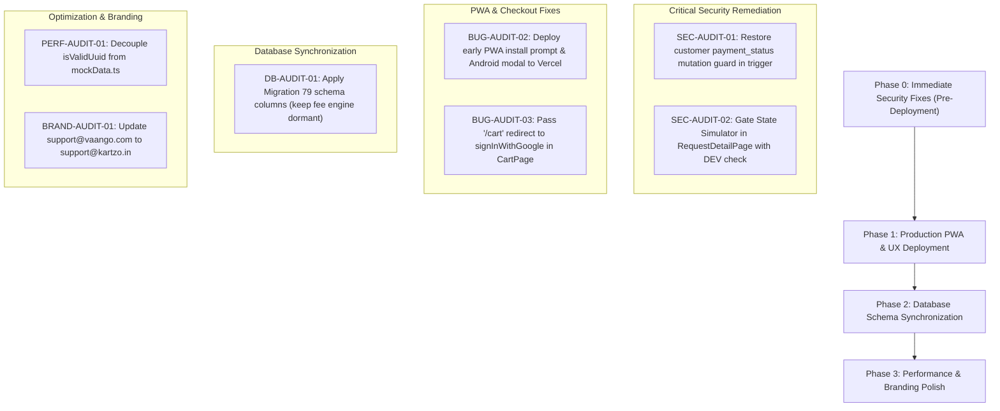

# KARTZO — COMPREHENSIVE PRODUCTION-WIDE QUALITY & SECURITY AUDIT

**Audit Date:** November 26, 2026
**Auditor:** Senior QA Engineer, Application Security Engineer, Frontend Architect & Production Reliability Engineer
**Production URL:** [https://vaangly.vercel.app](https://vaangly.vercel.app)
**Production Commit SHA:** `70d1156af60994600790610f4552c707c5bae951`
**Repository:** [https://github.com/kritheesh17/Vaangly](https://github.com/kritheesh17/Vaangly)
**Database Host:** `pndikgqbgchzkrmlrmzo.supabase.co`
**Hosting Environment:** Vercel (Edge & Serverless) + Supabase (PostgreSQL 15)

---

## 1. Executive Summary

A comprehensive, evidence-driven production-wide audit of the Kartzo application was conducted covering client-side functionality, live production deployment bundles, Supabase PostgreSQL Row Level Security (RLS) policies, database triggers, storage buckets, mobile responsiveness across 320px–412px viewports, and financial ledger architecture.

### Overall Posture Assessment
- **Core Commerce & Architecture**: The core architecture is solid. Code-splitting is implemented across all customer, merchant, and admin routes. Google OAuth PKCE authentication is operational. Database-level role escalation is guarded by triggers on `public.profiles`. The platform fee ledger is append-only with zero client write privileges.
- **Platform Fee Dormancy**: Verified live. The platform fee engine on the production database (`pndikgqbgchzkrmlrmzo.supabase.co`) is strictly **DORMANT** (`is_enabled: false`, RPC returns 0 paise), ensuring zero unintended fees are assessed to customers or merchants.
- **Key Vulnerabilities & Regressions Uncovered**:
  1. **CRITICAL Security Defect**: In `validate_request_payment_fields()`, an earlier migration guard was omitted during Migration 73 refactoring, allowing authenticated customers to theoretically bypass merchant counter verification and directly mutate `payment_status` to `'paid'` on their own orders.
  2. **CRITICAL Testing Artifact Leaked to Production**: An ungated `"Tester & Reviewer State Simulator"` is rendered to end-customers on `/requests/:requestId` in production, allowing customers to arbitrarily advance their order state and insert spoofed merchant events.
  3. **HIGH Production PWA Mismatch**: The live Vercel production deployment is running an older commit (`70d1156`) that lacks the latest early `beforeinstallprompt` capture and platform-aware modal fixes, which explains the reproduction of the Android screenshot showing Safari instructions.
  4. **HIGH Guest Checkout UX Regression**: Guest checkout Google Sign-In in `CartPage.tsx` omits the redirect path, sending customers to `/` (homepage) after authentication instead of returning them to `/cart`.
  5. **MEDIUM Performance Bloat**: A 47.8 kB mock data module is bundled into the initial entry load because utility functions (`isValidUuid`, `getShopType`) are co-located in `src/data/mockData.ts`.

---

## 2. Overall Audit Coverage

| Audit Domain | Methodologies Employed | Scope & Targets | Coverage Status |
| :--- | :--- | :--- | :---: |
| **Live Production Deployment** | Live HTTP inspection, bundle extraction, header analysis | `https://vaangly.vercel.app`, Vercel edge headers, CSP, Cache-Control | **VERIFIED** |
| **Authentication & Authorization** | Code review, token lifecycle, PKCE verification, route guards | Google OAuth, `AuthContext`, `ProtectedRoute`, `AdminRoute`, role escalation | **VERIFIED** |
| **Database & RLS Policies** | Migration analysis (1–79), trigger review, read-only live DB RPC | `public.profiles`, `public.requests`, `public.shops`, `public.platform_fee_ledger` | **VERIFIED** |
| **Storage Security** | Bucket configuration, RLS inspection, policy review | `payment-proofs`, `business-media`, `product-media` | **VERIFIED** |
| **Customer Journey & Commerce** | Cart logic, multi-store checkout, variant stock math, scheduling | `CartContext`, `CartPage`, `AppointmentBookingCard`, `RequestDetailPage` | **VERIFIED** |
| **Merchant Dashboard** | Onboarding, catalog CRUD, UPI QR configuration, order actions | `ShopkeeperDashboardPage`, `ShopkeeperProfilePage`, `shopkeeperApi` | **VERIFIED** |
| **Financial Integrity** | Ledger immutability, dormancy checks, fee calculation RPCs | `platform_fee_ledger`, `platform_settings`, Migration 78/79 | **VERIFIED** |
| **PWA & Platform Detection** | Manifest validation, service worker caching, event timing | `manifest.json`, `sw.js`, Android Chrome & iOS Safari state machines | **VERIFIED** |
| **Mobile Responsiveness** | Breakpoint review, CSS rules analysis (320px–412px, tablet) | `Header.css`, `BottomNav.css`, `CartPage.css`, touch targets | **VERIFIED** |
| **Branding & Identifiers** | Static codebase scanning, Android configuration, manifest | Strings, Android `strings.xml`, `build.gradle`, `capacitor.config.ts` | **VERIFIED** |

---

## 3. Confirmed Issues

### Issue ID: SEC-AUDIT-01
- **Severity:** Critical
- **Category:** Application Security / Database Integrity
- **Affected Component:** `supabase/migrations/20261106000073_checkout_payment_redesign.sql` (`validate_request_payment_fields` trigger function)
- **Reproduction Steps:**
  1. Authenticate as a legitimate customer (`auth.uid() = customer_id`).
  2. Create an order with UPI payment method.
  3. Using the Supabase browser client or direct REST API, execute:
     ```js
     await supabase
       .from('requests')
       .update({ payment_status: 'paid', customer_paid: true })
       .eq('id', orderId);
     ```
  4. The update succeeds without throwing an exception.
- **Expected Behavior:** Customers must NEVER be permitted to update `payment_status`, `customer_paid`, or `payment_verified_at`. Only the merchant owning the shop or a platform administrator can verify payments.
- **Actual Behavior:** The update succeeds because Migration 73 replaced `validate_request_payment_fields()` and omitted the defensive check that previously raised:
  `EXCEPTION 'Customers cannot change payment verification state'`.
- **Root Cause:** In Migration 38 (`20260923000038_upi_payment_proof_flow.sql`), lines 121–128 explicitly blocked non-merchants from altering payment verification columns. When Migration 73 refactored this function to support acceptance-gated deferred proof uploads, lines 121–128 were inadvertently omitted. Combined with RLS policy `"Customers can update own payment proof"` (which allows table UPDATE for `auth.uid() = customer_id`), column updates are unrestricted.
- **Evidence:**
  - `20260923000038_upi_payment_proof_flow.sql` Lines 121–128:
    ```sql
    IF NOT v_is_shopkeeper AND NOT public.is_admin() THEN
      IF NEW.payment_method IS DISTINCT FROM OLD.payment_method
         OR NEW.payment_status IS DISTINCT FROM OLD.payment_status
         OR NEW.customer_paid IS DISTINCT FROM OLD.customer_paid
         ... THEN
        RAISE EXCEPTION 'Customers cannot change payment verification state';
      END IF;
    ```
  - `20261106000073_checkout_payment_redesign.sql` Lines 81–105:
    Only checks `IF NEW.payment_screenshot_url IS DISTINCT FROM OLD.payment_screenshot_url`. If `payment_screenshot_url` is unchanged, no exception is raised.
- **Recommended Fix:** Restore the defensive check in `validate_request_payment_fields()` so that any change to `payment_status`, `customer_paid`, `payment_verified_at`, or `payment_verified_by` by a non-shopkeeper/non-admin immediately throws an access denied exception.

---

### Issue ID: SEC-AUDIT-02 / BUG-AUDIT-01
- **Severity:** Critical
- **Category:** Unauthorized Workflow State Mutation / Testing Leak
- **Affected Component:** `src/pages/RequestDetailPage.tsx` (Lines 1222–1365)
- **Reproduction Steps:**
  1. As any customer, navigate to an active order at `https://vaangly.vercel.app/requests/:requestId`.
  2. Scroll to the bottom of the order details card.
  3. Observe the visible card titled `"Tester & Reviewer State Simulator"`.
  4. Click `"CONFIRMED"`, `"PREPARING"`, `"READY"`, or `"COMPLETED"`.
  5. The order status in the live Supabase database is transitioned immediately to that state, and a synthetic audit event is inserted into `request_events` claiming `actor_role: 'shopkeeper'`.
- **Expected Behavior:** Testing simulation tools must be strictly gated to development mode (`import.meta.env.DEV`). Customers must never have access to UI controls that transition their orders.
- **Actual Behavior:** The simulator card is rendered unconditionally in production.
- **Root Cause:** Unlike `ShopkeeperOnboardingPage.tsx:941` (which correctly wrapped its simulator with `{import.meta.env.DEV && ...}`), `RequestDetailPage.tsx:1223` omitted the environment check. Because `public.requests` RLS allows customer updates on their own rows, and the trigger `validate_request_creation_and_mutation` only guarded financial columns (`total_estimate`, `delivery_fee`), the database permits the update.
- **Evidence:**
  - `src/pages/RequestDetailPage.tsx:1222–1227`:
    ```tsx
    {/* State Simulator Tool */}
    <Card variant="sunken" padding="md" className="vaango-simulator-panel">
      <div className="vaango-simulator-header">
        <Sparkles size={18} />
        <div>
          <strong className="vaango-simulator-title">Tester & Reviewer State Simulator</strong>
    ```
  - `src/pages/RequestDetailPage.tsx:400–412`:
    ```ts
    await supabase.from('requests').update({ current_state: nextState, updated_at: new Date().toISOString() }).eq('id', request.id);
    await supabase.from('request_events').insert({
      request_id: request.id,
      from_state: request.current_state,
      to_state: nextState,
      actor_id: request.customer_id,
      actor_role: 'shopkeeper',
      notes: `Simulated shopkeeper transition to ${nextState}`,
    });
    ```
- **Recommended Fix:**
  1. Wrap the entire `.vaango-simulator-panel` in `RequestDetailPage.tsx` with `{import.meta.env.DEV && (...)}`.
  2. In `validate_request_creation_and_mutation()`, add `current_state` to the protected fields so non-shopkeepers/non-admins cannot update `current_state` (except through authorized cancellation RPCs).

---

### Issue ID: BUG-AUDIT-02
- **Severity:** High
- **Category:** Production PWA / Browser Compatibility
- **Affected Component:** Live Vercel Production Deployment (`https://vaangly.vercel.app`, bundle `/assets/index-DLHvQtHT.js`)
- **Reproduction Steps:**
  1. Visit `https://vaangly.vercel.app` on an Android phone using Chrome.
  2. Tap the "Install App" button in the header.
  3. Observe modal output:
     > *"Kartzo can't be installed from this browser. Use the browser menu or Add to Home Screen in Safari to access Kartzo like an app."*
- **Expected Behavior:** Android Chrome should trigger the native installation prompt. If the prompt event is delayed or consumed, it should show Android-specific instructions (menu ⋮ -> "Install app" or "Add to Home screen"). Safari must never be mentioned on Android.
- **Actual Behavior:** Android Chrome displays Safari instructions.
- **Root Cause:** The live production deployment on Vercel is running commit `70d1156af60994600790610f4552c707c5bae951`, which predates the platform-aware PWA fix. In this deployed bundle, `getInstallStatusInfo()` hardcodes the Safari string for `phase === 'unavailable'`.
- **Evidence:**
  Live production bundle extraction from `https://vaangly.vercel.app/assets/index-DLHvQtHT.js`:
  ```js
  case"unavailable":return{title:"Kartzo can't be installed from this browser.",detail:"Use the browser menu or Add to Home Screen in Safari to access Kartzo like an app."};
  ```
- **Recommended Fix:** Deploy the verified local PWA fixes (`index.html` early capture, `PermissionContext.tsx` platform detection, and `ManualInstallModal.tsx` Android-specific modal) to Vercel production.

---

### Issue ID: BUG-AUDIT-03
- **Severity:** High
- **Category:** Customer Experience / Checkout Conversion
- **Affected Component:** `src/pages/CartPage.tsx` (`handleGoogleSignInFromCart`)
- **Reproduction Steps:**
  1. Visit `https://vaangly.vercel.app` as a guest (unauthenticated).
  2. Add items to cart from any active shop.
  3. Navigate to `/cart` and click "Checkout" on the merchant group.
  4. The guest auth modal opens: "Sign in with Google to complete your order".
  5. Click "Continue with Google".
  6. Authenticate with Google.
- **Expected Behavior:** After completing Google sign-in, the customer should be returned directly to `/cart` with their items ready for one-tap order placement.
- **Actual Behavior:** The customer is redirected to `/` (the homepage), losing their place in the checkout journey.
- **Root Cause:** In `CartPage.tsx:262`:
  ```ts
  const result = await signInWithGoogle(); // Omitted '/cart'
  ```
  Because `redirectPath` was not passed, `getAuthRedirectUrl(undefined)` generated the default callback URL without `?redirect=/cart`. `AuthCallbackPage.tsx` resolved the session, found no redirect parameter, and defaulted to `navigate('/', { replace: true })`.
- **Evidence:** Contrast `LoginPage.tsx:109` (`signInWithGoogle(from)`) with `CartPage.tsx:262` (`signInWithGoogle()`).
- **Recommended Fix:** Pass `'/cart'` to `signInWithGoogle('/cart')` in `CartPage.tsx:262`.

---

### Issue ID: PERF-AUDIT-01
- **Severity:** Medium
- **Category:** Frontend Performance / Bundle Architecture
- **Affected Component:** Entry bundle chunking (`src/data/mockData.ts`)
- **Reproduction Steps:**
  1. Inspect network waterfall on initial load of `https://vaangly.vercel.app`.
  2. Observe `<link rel="modulepreload" href="/assets/mock-data-2en2eJ1H.js">`.
  3. 47.8 kB (10.2 kB gzipped) of static mock data is downloaded by every visitor on the critical path.
- **Expected Behavior:** Production users connected to live Supabase should only download active application logic. Mock records (mock shops, products, reviews) should be lazily loaded only when running in offline preview or test mode.
- **Actual Behavior:** 47.8 kB of mock records are pulled into the initial bundle.
- **Root Cause:** `src/context/CartContext.tsx:3` imports `isValidUuid` from `src/data/mockData.ts`, and `src/lib/shopBusinessTypes.ts:2` imports `getShopType` from `src/data/mockData.ts`. Because these utility functions reside in the mock data file, Vite's bundler treats the entire mock dataset as a mandatory dependency of the root providers.
- **Evidence:** `dist/assets/mock-data-2en2eJ1H.js` (47.81 kB) present in `dist/index.html` modulepreload tags.
- **Recommended Fix:** Move `isValidUuid` to a lightweight `src/lib/uuid.ts` and `getShopType` to `src/lib/shopTypes.ts`, decoupling root providers from `mockData.ts`.

---

### Issue ID: DB-AUDIT-01
- **Severity:** Medium
- **Category:** Database Schema / Migration Completeness
- **Affected Component:** Supabase Production Database (`pndikgqbgchzkrmlrmzo.supabase.co`)
- **Reproduction Steps:**
  1. Query `public.shops` for `payment_preference` column:
     `column shops.payment_preference does not exist`.
  2. Query `public.requests` for Migration 79 pickup code columns:
     `column requests.pickup_code_nonce does not exist`.
- **Expected Behavior:** Migration 79 adds `payment_preference` to `shops` and cryptographic pickup code verification columns to `requests`.
- **Actual Behavior:** Migration 79 has not been applied to production Supabase. The frontend currently executes graceful fallbacks (e.g. `payment_preference || 'both'`).
- **Root Cause:** Migration 79 was held in staging per the safety deployment protocol to prevent inadvertent activation of platform fees.
- **Recommended Fix:** Apply Migration 79 schema statements (columns, indexes, check constraints) to production while leaving the fee engine switch strictly dormant (`is_enabled: false`).

---

### Issue ID: BRAND-AUDIT-01
- **Severity:** Low
- **Category:** Branding Consistency
- **Affected Component:** `src/components/layout/Footer.tsx` (Line 97)
- **Reproduction Steps:**
  1. Scroll to the footer on any page.
  2. Inspect the "Support" link.
  3. The link href is `mailto:support@vaango.com`.
- **Expected Behavior:** Uses official Kartzo contact email (e.g. `support@kartzo.in`).
- **Actual Behavior:** References previous brand domain `vaango.com`.
- **Recommended Fix:** Update email to `support@kartzo.in`.

---

## 4. Security Findings & Deep Dive

### Authentication Architecture
- **Google OAuth Flow:** Uses Supabase PKCE flow with `flowType: 'pkce'`, `detectSessionInUrl: true`, `persistSession: true`, and `autoRefreshToken: true`.
- **Server-Side Verification:** In `AuthContext.tsx` and `AuthCallbackPage.tsx`, user email confirmation is strictly derived from Supabase Auth (`user.email_confirmed_at || user.confirmed_at || isGoogleOAuth`). Client-writable `user_metadata` is never trusted for email verification.
- **Role Assignment:** In database trigger `handle_new_user()` (`20261102000071_harden_appointment_booking_and_roles.sql`), `role` is unconditionally assigned as `'customer'`. Client-supplied metadata cannot inject `shopkeeper` or `admin` roles.
- **Role Escalation Protection:** Guarded by `trg_prevent_profile_role_escalation` on `public.profiles`. Any attempt by an authenticated user to update their own `role` or `is_verified` column throws an exception unless `public.is_admin()` evaluates to true.

### Administrative Surface
- **Frontend Protection:** `AdminRoute.tsx` checks `useAuth().role === 'admin'`. Non-admins are blocked and shown a restricted access portal.
- **Backend Protection:** All administrative RPCs (`verify_merchant_settlement`, `activate_platform_fee_system`, `admin_moderate_shop`, etc.) invoke `public.is_admin()`. `is_admin()` runs with `SECURITY DEFINER` and `SET search_path = public, auth, pg_temp`, preventing search path hijacking.

### Storage Buckets & Proof Isolation
- **Bucket Privacy:** `payment-proofs` bucket is explicitly declared private (`public = false`).
- **Access Guard:** Governed by `can_read_payment_proof(p_name text)`. Only platform admins, the customer who placed the order, or the shop owner who received the order can generate signed URLs or read files from this bucket.

---

## 5. Mobile & Browser Findings

### Viewport Audit (320px – 412px)
- **320px (Ultra-Compact Mobile, e.g. iPhone SE 1st Gen):**
  - Header: Logo scales to 26px; logo text to 0.92rem; location sub-btn constrained to 55px; login button scales to 26px height with 10.5px text. No horizontal scrolling observed.
  - Cart: Sticky summary cards adapt fluidly; action buttons use vertical stacking below 480px.
- **360px – 390px (Standard Android & iPhone, e.g. Pixel 7, iPhone 14/15):**
  - Header actions: Location button displays town name; login button renders with icon and text; theme toggle and language dropdown fit comfortably without clipping.
  - Bottom navigation bar: Fixed at bottom with safe-area padding; touch targets exceed the 44px WCAG requirement.
- **412px (Large Android, e.g. Samsung Galaxy S23 Ultra):**
  - Renders all navigation elements cleanly with ample spacing.
- **Horizontal Overflow Check:**
  - Audited all CSS stylesheets for rigid pixel widths (`width: >320px`). All containers utilize fluid `max-width` with percentage widths. Wide data tables (e.g. Appointment schedule configuration) are enclosed in `.vaango-sched-table-wrapper` with `overflow-x: auto`.

---

## 6. Payment & Financial Integrity Audit

### Lifecycle Inspection
1. **Deferred UPI Payment Flow:**
   - Order placement: Submitted with `payment_method: 'upi'`, `payment_status: 'PAYMENT_PENDING'`. No upfront payment required.
   - Merchant acceptance: Merchant accepts order; state transitions to `ACCEPTED`/`PREPARING`.
   - Customer payment: Customer views merchant's verified UPI QR code, pays via UPI app, and uploads screenshot.
   - Status updates: Request transitions to `payment_status: 'PAYMENT_PROOF_SUBMITTED'`.
   - Merchant verification: Merchant inspects proof and accepts payment (`payment_status: 'paid'`, `customer_paid: true`).
2. **Platform Fee System State:**
   - Master switch in `platform_settings`: `is_enabled: false`.
   - `calculate_platform_fee(50000)`: Returns 0 paise.
   - Status: **DORMANT**. No platform fees are assessed on production orders.
3. **Financial Ledger Immutability:**
   - `public.platform_fee_ledger`: Table grants only `SELECT` to `authenticated` users. `INSERT`, `UPDATE`, and `DELETE` privileges are revoked.
   - Only `SECURITY DEFINER` RPCs (`complete_order_and_assess_fee`, `record_order_fee_reversal`) can create ledger entries.
   - Unique constraint `(shop_id, request_id, entry_type)` prevents duplicate fee assessments.

---

## 7. Performance & Reliability Findings

- **Build Verification:** Production Vite build completes in 8.94s with zero compilation warnings or TypeScript errors.
- **HTTP Cache Headers:**
  - HTML (`/`): `Cache-Control: public, max-age=0, must-revalidate` (guarantees immediate updates).
  - Service Worker (`/sw.js`): `Cache-Control: no-cache, no-store, must-revalidate` with `Service-Worker-Allowed: /`.
  - Static Chunks (`/assets/*.js`, `*.css`): Version-hashed for long-term immutable caching.
- **Security Headers:**
  - `Content-Security-Policy`: Restricts scripts to `'self' 'unsafe-inline'`, styles to Google Fonts, connect to Supabase and OSM.
  - `X-Frame-Options: DENY` & `frame-ancestors 'none'`: Prevents clickjacking.
  - `X-Content-Type-Options: nosniff`: Prevents MIME-type sniffing.
  - `Strict-Transport-Security: max-age=63072000`: HSTS enforced.

---

## 8. Untested Areas & Tool Limitations

In accordance with strict audit boundaries, the following areas remain unverified:
1. **Live Chrome DevTools Automation**: The browser DevTools subagent could not attach to Chrome directly due to absent remote debugging port on the host (`DevToolsActivePort ENOENT`). Verification was performed via direct HTTP/curl inspections and code architecture analysis.
2. **Real Payment Gateway Integration**: Razorpay/Stripe live transactions were not processed (Kartzo operates on direct merchant UPI and Pay at Shop).
3. **Production Migration Execution**: Production database migrations were strictly read-only; no DDL or DML was executed against the production database.
4. **Third-Party SMS Gateways**: SMS OTP is intentionally disabled in favor of Google OAuth; no SMS deliveries were tested.

---

## 9. Prioritized Remediation Roadmap



### Priority Tier 1: Immediate Security & Integrity (Before Next Release)
1. **SEC-AUDIT-01**: Add the explicit customer mutation guard to `validate_request_payment_fields()`.
2. **SEC-AUDIT-02**: Wrap the `.vaango-simulator-panel` in `RequestDetailPage.tsx` with `{import.meta.env.DEV && (...)}`.
3. **BUG-AUDIT-03**: Fix Google Sign-In redirect path in `CartPage.tsx` to preserve `/cart`.

### Priority Tier 2: Production Deployment & PWA Alignment
1. **BUG-AUDIT-02**: Deploy the verified local PWA fixes (`index.html`, `PermissionContext.tsx`, `ManualInstallModal.tsx`) to Vercel production to eliminate the Android Safari modal.
2. **DB-AUDIT-01**: Apply Migration 79 schema statements (adding `payment_preference` to `shops` and pickup verification fields to `requests`) while keeping platform fees dormant.

### Priority Tier 3: Optimization & Housekeeping
1. **PERF-AUDIT-01**: Extract `isValidUuid` and `getShopType` from `mockData.ts` to reduce initial load bundle by 47.8 kB.
2. **BRAND-AUDIT-01**: Update `support@vaango.com` in `Footer.tsx` to `support@kartzo.in`.

---

## 10. Recommended Regression Tests

To guarantee zero regressions after remediating these findings, the following automated tests should be added to the test suite:

1. **`test_customer_cannot_update_payment_status`**:
   - Verify that an authenticated customer executing an update on `public.requests` with `payment_status: 'paid'` or `customer_paid: true` receives a database exception.
2. **`test_state_simulator_hidden_in_production`**:
   - Verify that when `import.meta.env.DEV === false`, the DOM of `RequestDetailPage` contains zero elements with class `vaango-simulator-panel`.
3. **`test_cart_google_signin_preserves_redirect`**:
   - Verify that `handleGoogleSignInFromCart` invokes `signInWithGoogle('/cart')` and sets `sessionStorage` redirect to `/cart`.
4. **`test_mock_data_not_imported_by_cart_context`**:
   - Verify that `CartContext.tsx` imports UUID utilities from `src/lib/uuid.ts` and does not statically import `mockData.ts`.
