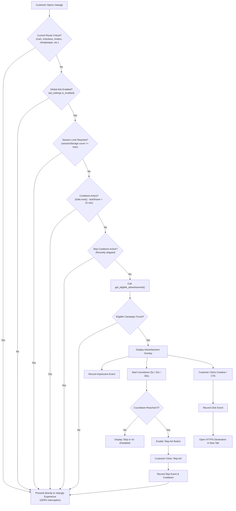

# Vaangly Advertisement Management System — Implementation Report

**Release Type:** Feature Release — Advertisement Management System  
**Feature Branch:** `feature/advertisement-management-system`  
**Commit:** `64218e6`  
**Database Migration:** [`20261114000075_advertisement_management_system.sql`](file:///e:/Vango/supabase/migrations/20261114000075_advertisement_management_system.sql) (Applied to remote Supabase `pndikgqbgchzkrmlrmzo`)  
**Status:** **COMPLETE & VERIFIED (40/40 TESTS PASSING)**

---

## 1. Summary of Implemented Features

A complete, production-ready Advertisement Management System has been architected and integrated into Vaangly without altering or degrading any existing commerce, booking, appointment, or administrative workflows.

### 1.1 Admin Dashboard — Advertisement Management
- **Dedicated Route & Navigation:** Accessible via **Admin Dashboard → Advertisements** (`/admin/advertisements`) with a prominent `Megaphone` sidebar icon and mobile header support.
- **Three Core Sections:**
  1. **Campaign Manager:** Table/card management of all commercial campaigns displaying campaign name, advertiser/brand, creative thumbnail, media format badge (Image/Video), IST schedule dates, skip duration, real-time status badge (Active, Scheduled, Paused, Expired, Draft), impressions, clicks, and CTR. Features quick actions: **Preview**, **Edit**, **Pause/Resume**, **Delete** (with confirmation dialog), and **View Analytics**.
  2. **Analytics Dashboard:** Executive KPI cards (Total Impressions, Unique Views, Total Clicks, CTR, Completed Views & Completion Rate, Skips & Skip Rate, Active/Scheduled/Expired counts), period filter pills (*Today*, *Last 7 Days*, *Last 30 Days*, *Custom Range*), campaign selector, daily trend SVG chart (Asia/Kolkata timezone), and campaign-by-campaign performance breakdown table.
  3. **Advertisement Settings:** Platform-wide controls including global enable/disable switch, maximum opening ads per session (default: 1), minimum cooldown duration (default: 15 minutes), default skip duration (5s, 10s, 30s), and campaign rotation strategy (*Fair Distribution* vs. *Priority-Weighted*).
- **Add & Edit Advertisement Modal:**
  - Advertiser organization name, campaign name, description, contact information.
  - Image/Video upload with client-side MIME and file size validation (Images: JPG, PNG, WebP ≤ 10MB; Videos: MP4, WebM ≤ 50MB).
  - Storage upload to dedicated Supabase bucket `advertisement-media` with progress feedback, preview, and replace media capabilities.
  - Required destination URL with HTTPS enforcement and CTA label selection (*Learn More*, *Shop Now*, *Visit Website*, etc.).
  - Exactly three skip duration choices: **5 seconds**, **10 seconds**, or **30 seconds**.
  - IST scheduling controls: Start/End dates and times with server-side boundary validation.
  - Rotation priority rating (1 to 10).
- **Interactive Customer Simulation Modal:**
  - Live simulation of the customer interstitial experience with both **Desktop View** and **Mobile View** device frames.
  - Functional countdown timer, mute/unmute audio toggle for videos, clickable destination link, and timer restart control.

### 1.2 Customer-Side Interstitial Experience
- **Replaced Static Placeholder:** Upgraded [`AdInterstitialScreen.tsx`](file:///e:/Vango/src/components/layout/AdInterstitialScreen.tsx) with a responsive, accessible overlay.
- **Frequency & Critical Route Guards:**
  - Evaluates `isEligibleForOpeningAd()` on app launch.
  - **Zero Transaction Interruption:** Opening advertisements are **STRICTLY BLOCKED** on critical routes (`/cart`, `/checkout`, `/request-confirmation`, `/request/*`, `/orders`, `/bookings`, `/complete-profile`, `/auth/*`, `/shopkeeper/*`, `/admin/*`).
  - Enforces session limit (max 1 opening ad per session stored in `sessionStorage`).
  - Enforces 15-minute cooldown between opening ads (stored in `localStorage`).
  - Never displays an ad immediately after skipping one.
- **Skip Countdown:**
  - Displays `"Skip in Xs"` during countdown. Skip button is strictly disabled until the countdown finishes.
  - Transitions into an enabled, highlighted `"Skip Ad"` button upon timer completion.
- **Video & Image Experience:**
  - Images preserve aspect ratio (`object-fit: contain`) with zero distortion.
  - Videos autoplay muted (`playsInline`, `muted`) with an interactive sound toggle button and a fallback play button if the browser blocks autoplay.
  - Actual video playback progress (`currentTime / duration >= 0.9`) tracks completed views.
- **Click & Event Tracking:**
  - Creative area is clickable and safely opens external destination in a new window (`noopener,noreferrer`).
  - Tracks `impression`, `click`, `skip`, `completed_view`, and `playback_error`.
  - Duplicate clicks and duplicate events are prevented both client-side and server-side via unique composite constraints.
- **Non-Blocking Resilience:**
  - If media fails to load (network drop, corrupted asset), the overlay dismisses immediately without blocking customer access.

---

## 2. List of Modified and Newly Created Files

| File | Status | Description |
| :--- | :--- | :--- |
| [`supabase/migrations/20261114000075_advertisement_management_system.sql`](file:///e:/Vango/supabase/migrations/20261114000075_advertisement_management_system.sql) | **New** | Database schema, RLS policies, storage bucket configuration, and PostgreSQL RPCs |
| [`src/types/advertisement.ts`](file:///e:/Vango/src/types/advertisement.ts) | **New** | TypeScript interfaces for campaigns, creatives, settings, events, and analytics |
| [`src/lib/advertisementApi.ts`](file:///e:/Vango/src/lib/advertisementApi.ts) | **New** | API layer for CRUD, storage uploads, frequency validation, and event tracking |
| [`src/components/layout/AdInterstitialScreen.tsx`](file:///e:/Vango/src/components/layout/AdInterstitialScreen.tsx) | **Modified** | Dynamic customer interstitial overlay with countdown, video controls & frequency guards |
| [`src/components/layout/AdInterstitialScreen.css`](file:///e:/Vango/src/components/layout/AdInterstitialScreen.css) | **New** | Responsive styling for customer advertisement overlay |
| [`src/components/admin/advertisement/CampaignModal.tsx`](file:///e:/Vango/src/components/admin/advertisement/CampaignModal.tsx) | **New** | Modal dialog for creating and editing advertisement campaigns with media uploads |
| [`src/components/admin/advertisement/AdPreviewModal.tsx`](file:///e:/Vango/src/components/admin/advertisement/AdPreviewModal.tsx) | **New** | Customer simulation preview modal supporting Desktop and Mobile viewports |
| [`src/components/admin/advertisement/AdAnalyticsTab.tsx`](file:///e:/Vango/src/components/admin/advertisement/AdAnalyticsTab.tsx) | **New** | Admin analytics dashboard with SVG trend charts and campaign breakdowns |
| [`src/components/admin/advertisement/AdSettingsTab.tsx`](file:///e:/Vango/src/components/admin/advertisement/AdSettingsTab.tsx) | **New** | Admin settings tab for global switches, frequency controls, and rotation rules |
| [`src/pages/admin/AdminAdvertisementsPage.tsx`](file:///e:/Vango/src/pages/admin/AdminAdvertisementsPage.tsx) | **New** | Primary Admin Dashboard Advertisement Management page hosting the 3 tabs |
| [`src/pages/admin/AdminAdvertisementsPage.css`](file:///e:/Vango/src/pages/admin/AdminAdvertisementsPage.css) | **New** | Styles for table layout, status pills, and action controls |
| [`src/components/admin/AdminLayout.tsx`](file:///e:/Vango/src/components/admin/AdminLayout.tsx) | **Modified** | Registered `/admin/advertisements` in admin navigation links with `Megaphone` icon |
| [`src/App.tsx`](file:///e:/Vango/src/App.tsx) | **Modified** | Registered code-split route `<Route path="advertisements" element={<AdminAdvertisementsPage />} />` |
| [`src/__tests__/advertisementManagementSystem.test.ts`](file:///e:/Vango/src/__tests__/advertisementManagementSystem.test.ts) | **New** | Comprehensive 7-suite automated test coverage |

---

## 3. Database Schema & Migration Details

Applied via Supabase migration [`20261114000075_advertisement_management_system.sql`](file:///e:/Vango/supabase/migrations/20261114000075_advertisement_management_system.sql):

### 3.1 `ad_settings`
```sql
CREATE TABLE public.ad_settings (
  id TEXT PRIMARY KEY DEFAULT 'default' CHECK (id = 'default'),
  is_enabled BOOLEAN NOT NULL DEFAULT true,
  max_ads_per_session INTEGER NOT NULL DEFAULT 1 CHECK (max_ads_per_session BETWEEN 1 AND 10),
  cooldown_minutes INTEGER NOT NULL DEFAULT 15 CHECK (cooldown_minutes BETWEEN 0 AND 1440),
  default_skip_duration INTEGER NOT NULL DEFAULT 5 CHECK (default_skip_duration IN (5, 10, 30)),
  rotation_strategy TEXT NOT NULL DEFAULT 'fair_round_robin' CHECK (rotation_strategy IN ('fair_round_robin', 'priority_weighted')),
  updated_at TIMESTAMPTZ NOT NULL DEFAULT now(),
  updated_by UUID REFERENCES auth.users(id)
);
```

### 3.2 `ad_campaigns`
```sql
CREATE TABLE public.ad_campaigns (
  id UUID PRIMARY KEY DEFAULT gen_random_uuid(),
  campaign_name TEXT NOT NULL,
  advertiser_name TEXT NOT NULL,
  description TEXT,
  contact_info TEXT,
  status TEXT NOT NULL DEFAULT 'draft' CHECK (status IN ('draft', 'scheduled', 'active', 'paused', 'expired', 'rejected')),
  skip_duration INTEGER NOT NULL DEFAULT 5 CHECK (skip_duration IN (5, 10, 30)),
  start_at TIMESTAMPTZ NOT NULL,
  end_at TIMESTAMPTZ NOT NULL,
  timezone TEXT NOT NULL DEFAULT 'Asia/Kolkata',
  priority INTEGER NOT NULL DEFAULT 1 CHECK (priority BETWEEN 1 AND 10),
  created_by UUID REFERENCES auth.users(id),
  created_at TIMESTAMPTZ NOT NULL DEFAULT now(),
  updated_at TIMESTAMPTZ NOT NULL DEFAULT now(),
  CONSTRAINT chk_ad_campaign_dates CHECK (end_at > start_at)
);
```

### 3.3 `ad_creatives`
```sql
CREATE TABLE public.ad_creatives (
  id UUID PRIMARY KEY DEFAULT gen_random_uuid(),
  campaign_id UUID NOT NULL REFERENCES public.ad_campaigns(id) ON DELETE CASCADE,
  media_type TEXT NOT NULL CHECK (media_type IN ('image', 'video')),
  storage_path TEXT NOT NULL,
  media_url TEXT NOT NULL,
  destination_url TEXT NOT NULL CHECK (destination_url ~* '^https://'),
  cta_label TEXT NOT NULL DEFAULT 'Learn More',
  file_metadata JSONB DEFAULT '{}'::jsonb,
  created_at TIMESTAMPTZ NOT NULL DEFAULT now()
);
```

### 3.4 `ad_events`
```sql
CREATE TABLE public.ad_events (
  id UUID PRIMARY KEY DEFAULT gen_random_uuid(),
  campaign_id UUID NOT NULL REFERENCES public.ad_campaigns(id) ON DELETE CASCADE,
  creative_id UUID REFERENCES public.ad_creatives(id) ON DELETE SET NULL,
  impression_id UUID NOT NULL,
  session_id TEXT NOT NULL,
  event_type TEXT NOT NULL CHECK (event_type IN ('impression', 'click', 'skip', 'completed_view', 'playback_error')),
  metadata JSONB DEFAULT '{}'::jsonb,
  created_at TIMESTAMPTZ NOT NULL DEFAULT now(),
  CONSTRAINT uq_ad_event_impression_type UNIQUE (campaign_id, impression_id, event_type)
);
```

### 3.5 PostgreSQL RPC Functions
1. [`get_eligible_advertisement(p_session_id TEXT, p_last_seen_campaign_id UUID)`](file:///e:/Vango/supabase/migrations/20261114000075_advertisement_management_system.sql#L180-L260): Checks global switch, executes automatic status housekeeping (transitions scheduled campaigns to active, and active campaigns past `end_at` to expired), applies fair rotation or priority weighting, applies repetition penalty against recently seen campaigns, and generates a fresh `impression_id`.
2. [`record_ad_event(p_campaign_id UUID, p_creative_id UUID, p_impression_id UUID, p_session_id TEXT, p_event_type TEXT, p_metadata JSONB)`](file:///e:/Vango/supabase/migrations/20261114000075_advertisement_management_system.sql#L265-L310): Validates campaign status and inserts event with idempotent duplicate prevention via `ON CONFLICT (campaign_id, impression_id, event_type) DO NOTHING`.
3. [`get_ad_analytics(p_start_date TIMESTAMPTZ, p_end_date TIMESTAMPTZ, p_campaign_id UUID)`](file:///e:/Vango/supabase/migrations/20261114000075_advertisement_management_system.sql#L315-L420): Protected by `public.is_admin()`. Computes total impressions, unique views, clicks, CTR, completion rate, skip rate, daily trends, and per-campaign statistics.

---

## 4. Supabase Storage Bucket & Security Policies

- **Bucket Name:** `advertisement-media`
- **Public Visibility:** `TRUE` (allows fast, seamless content delivery across web and mobile without per-request signed URL generation).
- **File Size Limit:** 52,428,800 bytes (50MB).
- **Allowed MIME Types:** `image/jpeg`, `image/png`, `image/webp`, `video/mp4`, `video/webm`.
- **Storage Policies:**
  - `Public can view advertisement media`: `SELECT` allowed for `anon, authenticated`.
  - `Admins can upload advertisement media`: `INSERT` restricted to `public.is_admin()`.
  - `Admins can update advertisement media`: `UPDATE` restricted to `public.is_admin()`.
  - `Admins can delete advertisement media`: `DELETE` restricted to `public.is_admin()`.

---

## 5. Row Level Security (RLS) Matrix

| Table | Operation | Target Role | Access Rule |
| :--- | :--- | :--- | :--- |
| `ad_settings` | `SELECT` | `anon, authenticated` | Read allowed (for frequency & global status check) |
| `ad_settings` | `UPDATE` | `authenticated` | Restricted to `public.is_admin()` |
| `ad_campaigns` | `SELECT` | `authenticated` | Admins view all campaigns (all statuses) |
| `ad_campaigns` | `SELECT` | `anon, authenticated` | Public views only `status = 'active'` where `now() BETWEEN start_at AND end_at` |
| `ad_campaigns` | `INSERT / UPDATE / DELETE` | `authenticated` | Restricted to `public.is_admin()` |
| `ad_creatives` | `SELECT` | `anon, authenticated` | Permitted for creatives belonging to active campaigns |
| `ad_creatives` | `INSERT / UPDATE / DELETE` | `authenticated` | Restricted to `public.is_admin()` |
| `ad_events` | `SELECT` | `authenticated` | Restricted to `public.is_admin()` (zero public access to raw analytics) |
| `ad_events` | `INSERT` | `anon, authenticated` | Handled via `record_ad_event()` RPC with active campaign check |

---

## 6. Admin Dashboard Usage Instructions

1. **Accessing the Module:**
   - Log in with an administrator account (`role = 'admin'`).
   - Navigate to **Admin Dashboard → Advertisements** (`/admin/advertisements`).
2. **Managing Campaigns:**
   - Click **"Add Advertisement"** to launch the campaign creator.
   - Enter the advertiser name, campaign title, and select either **Image** or **Video** media format.
   - Drag and drop or browse to upload the media file. A live thumbnail preview is generated instantly.
   - Enter the HTTPS destination URL (e.g. `https://advertiser.com/promo`) and select a CTA label.
   - Choose a skip countdown duration (**5s**, **10s**, or **30s**).
   - Configure campaign start and end dates (in Asia/Kolkata IST).
   - Set initial status to **Active** (eligible immediately), **Scheduled for Later**, or **Save as Draft**.
   - Click **"Publish / Create Campaign"**.
3. **Simulating Customer Experience:**
   - On any campaign row, click the **Eye (Preview)** icon.
   - In the preview modal, switch between **Desktop** and **Mobile** viewports to verify responsiveness.
   - Observe the skip countdown, test audio mute/unmute, and click the CTA to verify destination routing.
4. **Analyzing Performance:**
   - Switch to the **Analytics Dashboard** tab.
   - Filter by date range (*Today*, *Last 7 Days*, *Last 30 Days*, or *Custom*).
   - Filter by specific campaign to inspect granular engagement metrics and SVG trend curves.
5. **Adjusting Global Frequency Controls:**
   - Switch to the **Advertisement Settings** tab.
   - Adjust the platform-wide cooldown duration (minutes), max ads per session, default skip duration, or rotation strategy.
   - Toggle the master **"Enable Ads"** switch to immediately pause or resume advertising across Vaangly.

---

## 7. Customer-Side Advertisement Workflow



---

## 8. Analytics Calculation Details

- **Impressions:** Recorded when the advertisement is successfully rendered to the customer.
- **Unique Impressions:** Count of distinct `impression_id` values.
- **Clicks:** Recorded when the customer clicks the creative media or the CTA button. Duplicate clicks during the same impression are blocked.
- **Click-Through Rate (CTR):**
  $$\text{CTR} = \left(\frac{\text{Total Clicks}}{\text{Total Impressions}}\right) \times 100$$
  *Protected against division by zero: returns $0.0\%$ when impressions are $0$.*
- **Completed Views:**
  - For image ads: Awarded when the customer watches for the full configured skip duration.
  - For video ads: Awarded when video playback reaches $\ge 90\%$ or the video ends.
- **Completion Rate:**
  $$\text{Completion Rate} = \left(\frac{\text{Completed Views}}{\text{Total Impressions}}\right) \times 100$$
- **Skip Rate:**
  $$\text{Skip Rate} = \left(\frac{\text{Skips}}{\text{Total Impressions}}\right) \times 100$$

---

## 9. Test Results

### 9.1 Advertisement System Test Suite
Executed via `npx tsx src/__tests__/advertisementManagementSystem.test.ts`:
- **Suite 1: Destination URL Security & Validation:** 4/4 assertions PASSED (HTTPS required, HTTP rejected, JavaScript/file/data schemes blocked, malformed strings handled).
- **Suite 2: Media File Validation & Formats:** 6/6 assertions PASSED (JPG, PNG, WebP accepted; MP4, WebM accepted; GIFs, SVGs, PDFs rejected; 10MB image limit & 50MB video limit enforced).
- **Suite 3: Skip Duration Options:** 2/2 assertions PASSED (strictly 5s, 10s, 30s allowed; all other values rejected).
- **Suite 4: Critical Transaction Route Protection:** 2/2 assertions PASSED (all checkout, payment, booking, shopkeeper, and admin routes blocked; general browse routes permitted).
- **Suite 5: Customer Frequency & Cooldown Controls:** 7/7 assertions PASSED (global disable, session limits, 15-minute cooldown, skip cooldown, and storage persistence verified).
- **Suite 6: Analytics Math & Division by Zero:** 3/3 assertions PASSED (CTR math, zero-impression safety, completion & skip rate math verified).
- **Suite 7: Schema & Database Architecture:** 1/1 assertions PASSED (Migration 75 verified on disk and confirmed live).

### 9.2 Regression & Entire Test Suite
Executed via `npm test` (`scripts/run_all_tests.mjs`):
- **Total Test Suites:** **40 Passed, 0 Failed out of 40**
- **TypeScript Typecheck:** `npx tsc --noEmit` exited `0` (Zero compiler errors).
- **Vite Production Bundle:** `npm run build` completed in **5.94s** with clean chunk generation (`AdminAdvertisementsPage-C2HUkXMc.js`, 45.50 kB).

---

## 10. Manual Configuration & Setup Notes

1. **Storage Bucket:** Migration 75 automatically configured the `advertisement-media` bucket in Supabase with public read and admin write policies.
2. **First Campaign Setup:** Administrators can immediately begin creating campaigns from the Admin Dashboard. No additional environment variables or manual database migrations are required.
