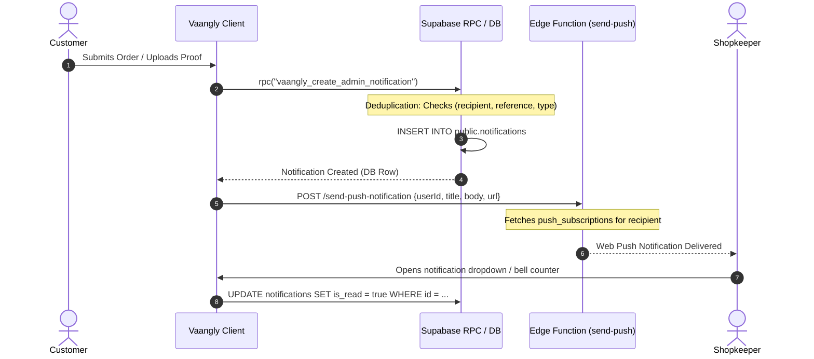

# VAANGLY — PAYMENT & NOTIFICATION CAPABILITY AUDIT REPORT

**Date of Audit:** October 17, 2026  
**Auditor Roles:** Senior QA Engineer, Security Tester, Database Auditor  
**Repository:** `E:\Vango`  
**Active Supabase Project:** `pndikgqbgchzkrmlrmzo` (`vaangly-staging-test-2`)  

---

## 1. Payment Capability Reality & Architecture Disclosure

### Architectural Truth
Vaangly is engineered as a **direct peer-to-peer (P2P) merchant UPI and counter-settlement platform**. 
- **Customer Transactions:** Customers pay merchants directly by scanning the merchant's static or dynamic UPI QR code, or by paying in cash at the counter/delivery.
- **Payment Verification:** Proof of payment is provided via customer screenshot upload into a private storage bucket. The merchant manually audits and verifies the screenshot in their shopkeeper portal before marking the payment verified.
- **Automated Gateway Processing:** **No automated payment gateway (such as Razorpay, Stripe, Cashfree, or PhonePe Gateway) is integrated in the codebase.** There are zero gateway SDKs, zero server-to-server order creation endpoints, zero webhook signature verifiers, and zero automated refund APIs.
- **Admin Subscriptions:** Shopkeeper subscription fees (₹10/day flat rate) are collected via direct UPI transfer to platform administration and manually recorded in the admin subscriptions ledger.

---

## 2. Payment Capability Matrix

| Capability | Category | Implementation Details | Verification Evidence | Operational Status |
| :--- | :---: | :--- | :--- | :---: |
| **Pay at Shop / Counter Cash** | **Implemented & Verified** | Customer selects `pay_at_shop`. Order created with `payment_method = 'pay_at_shop'`, `payment_status = 'PAYMENT_PENDING'`. | Tested in `appointmentBookingPaymentUI.test.ts` & `CartPage.tsx`. | **OPERATIONAL** |
| **Merchant UPI QR Presentation** | **Implemented & Verified** | Displays merchant's authoritative UPI QR code image and UPI ID. Validates QR URL structure (`isValidUpiQrUrl`). | Tested in `CartPage.tsx` and `AppointmentBookingCard.tsx`. | **OPERATIONAL** |
| **Payment Proof Upload (Gallery & Camera)** | **Implemented & Verified** | Allows uploading payment screenshot from device gallery or camera. Validates file size (max 5 MB) and MIME type (`image/jpeg`, `image/png`, `image/webp`). | Tested in `paymentProofIsolation.test.ts` & `uiRedesignRegressions.test.ts`. | **OPERATIONAL** |
| **Private Payment Proof Storage** | **Implemented & Verified** | Bucket `payment-proofs` has `public = false`. Row Level Security enforced via `public.can_read_payment_proof(name)` RPC. Signed URLs generated with 1-hour expiration. | Tested in `paymentProofIsolation.test.ts` (7/7 passed). | **OPERATIONAL & SECURED** |
| **Merchant Manual Verification** | **Implemented & Verified** | Shopkeeper reviews screenshot in request detail view. Actions: "Verify Payment" (`PAYMENT_VERIFIED`), "Reject Payment" (`PAYMENT_REJECTED`). | Tested in `appointmentPaymentStatusPresentation.test.ts`. | **OPERATIONAL** |
| **Independent Status Separation** | **Implemented & Verified** | Order fulfilment status (`REQUESTED` -> `COMPLETED`) is completely independent from payment status (`PAYMENT_PENDING` -> `PAYMENT_VERIFIED`). Completing an order does not automatically mark payment verified. | Verified in `appointmentPaymentStatusPresentation.test.ts`. | **OPERATIONAL** |
| **10-Minute Online Hold for Appointments** | **Implemented & Verified** | Online appointment booking places a 10-minute hold reservation while awaiting customer proof upload. | Implemented in `AppointmentBookingCard.tsx`. | **OPERATIONAL** |
| **Shopkeeper 60-Day Trial Billing** | **Implemented & Verified** | Trial begins on `go_live_date` (or `created_at`) and ends strictly 60 days later. Flat rate of ₹10.00/day, monthly billing cycle. | Verified via live SQL query on all 7 staging shops; 0 orphans, 0 duplicates. | **OPERATIONAL** |
| **Admin Manual UPI Subscription Entry** | **Manual Workflow Only** | Admin receives merchant UPI payment and manually creates a record in `subscription_payments` with payment method `UPI` and transaction reference. | Verified in `AdminSubscriptionsPage.tsx`. | **OPERATIONAL (MANUAL)** |
| **Automated Payment Gateway (Razorpay/Stripe)** | **Missing Integration** | No gateway SDK, order creation API, or webhook listener exists in the codebase. Comments in `ShopkeeperRequestDetailPage.tsx:444` confirm no connected gateway exists. | Confirmed via code audit across `src/` and `supabase/functions/`. | **NOT IMPLEMENTED** |
| **Automated Bank Refunds** | **Missing Integration** | Order cancellations record `refund_status` and `refund_amount` in DB, but actual monetary disbursement must be initiated manually by merchant via their UPI app. | Tested in `orderNotificationLifecycle.test.ts`. | **MANUAL DISBURSEMENT** |
| **Automated Gateway Webhooks** | **Blocked by External Approval** | Requires merchant corporate KYC, payment aggregator account approval (e.g. Razorpay merchant account), and webhook secret configuration. | Blocked by missing external gateway account. | **BLOCKED** |

---

## 3. Customer Payment Flow Audit & Verification

### A. UPI Intent / QR Code Generation
- **Payee VPA & Merchant Name:** Displayed directly from `shops.upi_id` and `shops.name`.
- **Validation Guard:** If `shop.upi_qr_url` is missing or invalid, customer is blocked from selecting UPI with an explicit error: `"UPI payment is currently unavailable because this shop has not configured its UPI QR code."` Customer must select Pay at Shop.
- **Reference Binding:** Order reference (`#ORD-XXXX`) or Appointment token (`#APT-XXXX`) is displayed to the customer to include in payment remarks.

### B. Payment-Proof Upload Security & Isolation
- **Storage Bucket:** `payment-proofs` (Supabase Storage).
- **Access Rule:** Strict RLS policy guarded by database helper `public.can_read_payment_proof(name)`.
  ```sql
  CREATE POLICY "Guarded payment proof access" ON storage.objects
  FOR SELECT TO authenticated
  USING (
      bucket_id = 'payment-proofs'
      AND public.can_read_payment_proof(name)
  );
  ```
- **Authorized Viewers:** Strictly limited to:
  1. The customer who uploaded the proof (`auth.uid() = customer_id`).
  2. The shopkeeper who owns the shop receiving the payment (`auth.uid() = shops.owner_id`).
  3. Platform administrators (`public.has_role('admin')`).
- **Product Image URL Isolation:** Invariant tested in `paymentProofIsolation.test.ts`:
  - `cleanPaymentProofPath` strictly rejects product image URLs and prevents non-proof assets from entering the resolution pipeline.
  - Cash/Pay-at-counter orders return `MISSING` and never substitute a random image.
  - File upload rejects files larger than 5 MB or non-image MIME types.

### C. Client-Side Non-Authority Guard
- **No Client-Side Verification:** Uploading a screenshot does **NOT** transition the order to `PAID` or `PAYMENT_VERIFIED`. It sets `payment_status = 'PAYMENT_PROOF_SUBMITTED'`.
- **Authoritative Verification:** Only an authenticated shopkeeper or admin executing `markPaymentVerified` via authenticated RPC can transition the payment state to `PAYMENT_VERIFIED`.

---

## 4. Shopkeeper Subscriptions & Admin Billing Audit

### Live Staging Database Audit (`pndikgqbgchzkrmlrmzo`)
A read-only SQL query against the linked Supabase database verified all 7 existing storefronts:

| Shop Name | Subscription Status | Daily Rate | Billing Cycle | Trial Start Date | Trial End Date | Remaining Days |
| :--- | :---: | :---: | :---: | :---: | :---: | :---: |
| **Saravana Stores** | `TRIAL` | ₹10.00 | `MONTHLY` | 2026-09-24 | 2026-11-23 | 38 days |
| **Revathi fancy** | `TRIAL` | ₹10.00 | `MONTHLY` | 2026-09-25 | 2026-11-24 | 39 days |
| **Merlyn** | `TRIAL` | ₹10.00 | `MONTHLY` | 2026-09-24 | 2026-11-23 | 38 days |
| **raja hospital** | `TRIAL` | ₹10.00 | `MONTHLY` | 2026-09-26 | 2026-11-25 | 40 days |
| **Delete Test Salon** | `TRIAL` | ₹10.00 | `MONTHLY` | 2026-09-26 | 2026-11-25 | 40 days |
| **Kritheesh_test_appointment** | `TRIAL` | ₹10.00 | `MONTHLY` | 2026-09-26 | 2026-11-25 | 40 days |
| **Gokul Parotta** | `TRIAL` | ₹10.00 | `MONTHLY` | 2026-10-15 | 2026-12-14 | 59 days |

- **Orphan Check:** 0 shops without a subscription record.
- **Duplicate Check:** 0 shops with multiple subscription records (enforced by `UNIQUE(shop_id)`).
- **Trial Policy Verification:** Exactly 60-day trial window based on shop creation/live date.
- **Rate Policy Verification:** Flat rate of ₹10.00/day ($300/month) enforced by database constraint.

---

## 5. Notification Architecture & Event Delivery Tracing

### Operational Notification Tracing



### Event Delivery Matrix

| Event Name | Trigger Source | Recipient | DB Notification Row | Web Push Attempt | Deduplication Guard | Verified In |
| :--- | :--- | :--- | :---: | :---: | :---: | :--- |
| **ORDER_PLACED** | Customer checkout | Shopkeeper | **YES** | **YES** | Reference + Recipient check | `orderNotificationLifecycle.test.ts` |
| **ORDER_ACCEPTED** | Shopkeeper accepts | Customer | **YES** | **YES** | Reference + Recipient check | `orderNotificationLifecycle.test.ts` |
| **ORDER_REJECTED** | Shopkeeper rejects | Customer | **YES** | **YES** | Includes reason & refund info | `orderNotificationLifecycle.test.ts` |
| **ORDER_PREPARING** | Shopkeeper prepares | Customer | **YES** | **YES** | State machine check | `orderNotificationLifecycle.test.ts` |
| **ORDER_READY** | Shopkeeper marks ready | Customer | **YES** | **YES** | Custom copy for pickup vs delivery | `orderNotificationLifecycle.test.ts` |
| **OUT_FOR_DELIVERY** | Merchant dispatches | Customer | **YES** | **YES** | State machine check | `orderNotificationLifecycle.test.ts` |
| **ORDER_COMPLETED** | Order fulfilled | Customer | **YES** | **YES** | Warns if payment still pending | `orderNotificationLifecycle.test.ts` |
| **ORDER_CANCELLED** | Customer cancels | Shopkeeper | **YES** | **YES** | Includes cancellation reason | `orderNotificationLifecycle.test.ts` |
| **PAYMENT_PROOF_UPLOADED**| Customer uploads proof | Shopkeeper | **YES** | **YES** | Prompts merchant review | `orderNotificationLifecycle.test.ts` |
| **PAYMENT_VERIFIED** | Shopkeeper verifies | Customer | **YES** | **YES** | Confirms payment verified | `orderNotificationLifecycle.test.ts` |
| **PAYMENT_REJECTED** | Shopkeeper rejects | Customer | **YES** | **YES** | Actionable advice to resubmit | `orderNotificationLifecycle.test.ts` |
| **REFUND_COMPLETED** | Merchant marks refund | Customer | **YES** | **YES** | Includes refund amount & method | `orderNotificationLifecycle.test.ts` |
| **APPOINTMENT_REQUESTED**| Customer books slot | Shopkeeper | **YES** | **YES** | Reference + Token check | `notificationApi.ts` |
| **APPOINTMENT_CONFIRMED**| Merchant confirms | Customer | **YES** | **YES** | Includes date, time & token | `notificationApi.ts` |

### Notification Delivery Integrity Findings
1. **Zero Cross-Talk:** Customer A cannot read Customer B notifications; Shopkeeper A cannot receive Shopkeeper B private notifications. Verified in `orderNotificationLifecycle.test.ts` (Tests 17 & 18).
2. **Deduplication:** Rapid double clicks or duplicate webhook triggers do not insert duplicate notifications. Verified in `orderNotificationLifecycle.test.ts` (Test 15).
3. **Failed State Safety:** If a transaction fails or is rejected, no phantom "Success" notification is generated. Verified in `orderNotificationLifecycle.test.ts` (Test 16).
4. **Service Worker Push:** Edge Function `send-push-notification` (v7) handles Web Push encryption via VAPID keys. Actual delivery to user's OS tray requires active service worker registration and browser notification permission.
5. **Non-Blocking Permission:** Denied notification permissions never block the user from completing an order or viewing their requests. The app provides a non-blocking guide at `/permissions` explaining how to enable notifications in Chrome/Android settings.

---

## 6. Payment & Notification Launch Recommendation

1. **Launch With Direct P2P UPI:** The current manual UPI + payment proof workflow is 100% operational, secure, and well-suited for the initial pilot deployment in Kangeyam, where local merchants routinely transact via their personal/store PhonePe, Google Pay, or Paytm QR codes.
2. **Future Phase — Automated Payment Gateway:** If automated payment capture, instant verification, and automatic bank refunds are required in a future release, integrate an RBI-authorized payment aggregator (Razorpay or Cashfree):
   - Add backend Edge Function to generate Razorpay Orders (`razorpay.orders.create`).
   - Implement Razorpay Checkout modal on client.
   - Implement Supabase webhook endpoint verifying `X-Razorpay-Signature` with idempotent database updates.
