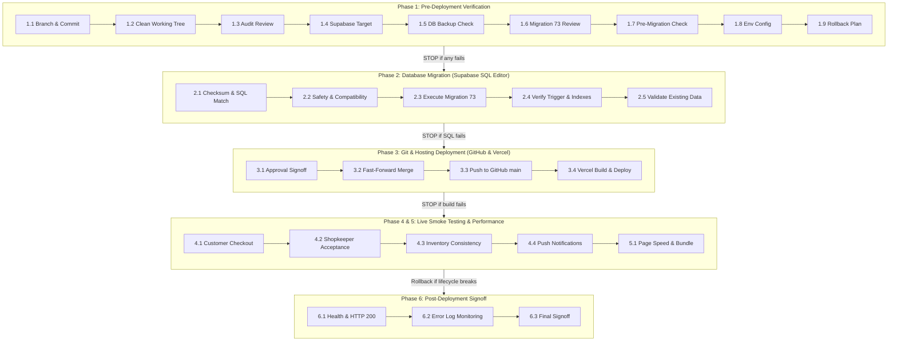

# Vaangly — Production Deployment Checklist

**Release Title:** Checkout Payment Redesign, Catalog Performance & Push Notification Hardening  
**Target Environment:** Production (`https://vaangly.vercel.app`)  
**Target Database:** Supabase `pndikgqbgchzkrmlrmzo` (`ap-northeast-1`)  
**Release Branch:** `fix/checkout-perf-push-reliability`  
**Release Commit:** `6e997f72eaa4819286c98d07c46fbe3778181783`  
**Migration:** `20261106000073_checkout_payment_redesign.sql`  
**Document Date:** November 6, 2026  
**Status:** Pre-Deployment Verification Complete — Awaiting Manual Deployment Execution  

---

## Deployment Workflow & Dependency Pipeline



---

## STOP Conditions & Emergency Protocol

> [!CAUTION]
> **HALT DEPLOYMENT IMMEDIATELY** if any of the following conditions occur:
> 1. **Migration Failure (Phase 2):** Any SQL error during execution of `20261106000073_checkout_payment_redesign.sql`. Do not push git commits; database remains in previous state.
> 2. **Divergent Main Branch (Phase 3):** `git merge --ff-only` fails because remote `origin/main` has diverged. Halt to reconcile git history.
> 3. **Vercel Build Failure (Phase 3):** Build command `npm run build` fails or chunk sizes exceed budgets. Rollback commit.
> 4. **Broken Checkout / Payment Gate (Phase 4):** Customers are able to upload payment proof before shopkeeper acceptance, or order submission fails. Trigger immediate Vercel Rollback to prior deployment and revert database function.
> 5. **Inventory Corruption (Phase 4):** Double deduction or inventory tracking bypassed. Halt and restore stock records.

---

## Phase 1: Pre-Deployment Verification

| ID | Task Description | Type | Dependency | Status | Verification Method | Evidence / Result | Responsible | Notes / Stop Condition |
| :--- | :--- | :---: | :---: | :---: | :--- | :--- | :---: | :--- |
| **1.1** | Verify release branch and commit | Mandatory | None | **Passed** | `git rev-parse HEAD`<br>`git branch --show-current` | `Branch: fix/checkout-perf-push-reliability`<br>`Commit: 6e997f72eaa4819286c98d07c46fbe3778181783` | Tech Lead | **STOP** if commit hash does not match `6e997f7...`. |
| **1.2** | Verify clean working tree | Mandatory | 1.1 | **Passed** | `git status` | `nothing to commit, working tree clean` | Tech Lead | **STOP** if uncommitted files exist. |
| **1.3** | Review latest audit report | Mandatory | 1.1 | **Passed** | Inspect `VAANGLY_PRE_DEPLOYMENT_SAFETY_REVIEW.md` | Pre-deployment safety report published with conditional approval. | Security Auditor | **STOP** if unaddressed security issues exist. |
| **1.4** | Verify production Supabase project | Mandatory | None | **Passed** | Inspect `.env` & active project configuration | Project ref: `pndikgqbgchzkrmlrmzo`<br>URL: `https://pndikgqbgchzkrmlrmzo.supabase.co` | DevOps | Confirm not pointing to legacy `czbywlmfrsbbcolbjdcw`. |
| **1.5** | Verify production database backup | Mandatory | 1.4 | **Pending** | Supabase Dashboard -> Backups -> Scheduled or Manual Backup | Snapshot created before running Migration 73. | Database Admin | **STOP** if no automated backup within last 24h. |
| **1.6** | Review Migration 73 source SQL | Mandatory | None | **Passed** | Inspect `20261106000073_checkout_payment_redesign.sql` | 138 lines verified; non-destructive; `CREATE OR REPLACE FUNCTION` and 3 indexes. | Database Admin | Verify syntax and security definer search path. |
| **1.7** | Check whether Migration 73 is already applied | Mandatory | 1.4 | **Passed** | Query `pg_proc` in Supabase SQL editor: `SELECT prosrc FROM pg_proc WHERE proname = 'validate_request_payment_fields';` | Confirmed: Trigger function currently has migration 56 definition (`UPI payment proof is required before submitting the request`). Migration 73 is **not** yet applied. | Database Admin | Must be applied before frontend deployment. |
| **1.8** | Confirm environment variables | Mandatory | 1.4 | **Passed** | Inspect `.env` & Vercel Dashboard env vars | `VITE_SUPABASE_URL`, `VITE_SUPABASE_PUBLISHABLE_KEY`, `VITE_VAPID_PUBLIC_KEY` present; no service-role key in frontend. | DevOps | Confirm keys match production. |
| **1.9** | Confirm rollback strategy | Mandatory | 1.6 | **Passed** | Review rollback script in audit report | Vercel 1-click redeploy ready; SQL rollback script documented. | Tech Lead | Ensure team knows exact rollback steps. |

---

## Phase 2: Database Migration

> [!IMPORTANT]
> **Execution Location:** Supabase Dashboard -> Project `pndikgqbgchzkrmlrmzo` -> SQL Editor.  
> **Rule:** Must be executed and verified **BEFORE** deploying frontend changes to Vercel.

| ID | Task Description | Type | Dependency | Status | Verification Method | Evidence / Result | Responsible | Notes / Stop Condition |
| :--- | :--- | :---: | :---: | :---: | :--- | :--- | :---: | :--- |
| **2.1** | Verify migration SQL matches audited version | Mandatory | 1.6 | **Pending** | Compare text of `supabase/migrations/20261106000073_checkout_payment_redesign.sql` | SHA-256 / exact line matching (138 lines). | Database Admin | **STOP** if content does not match audited SQL. |
| **2.2** | Confirm migration is safe for existing data | Mandatory | 2.1 | **Passed** | Code audit of Migration 73 | Zero `ALTER TABLE`, zero `DROP`, zero `DELETE`, zero `UPDATE` on existing rows. | Database Admin | Safe: additive indexes and idempotent function. |
| **2.3** | Apply Migration 73 in Supabase SQL Editor | Mandatory | 2.1, 2.2 | **Pending** | Paste and run complete SQL in Supabase Dashboard SQL Editor | Console returns: `Success. No rows returned.` | Database Admin | **STOP** on SQL error. Do not merge git branch. |
| **2.4** | Verify database function and indexes | Mandatory | 2.3 | **Pending** | Run verification queries:<br>1. Check function definition in `pg_proc`<br>2. Check indexes in `pg_indexes` | `SELECT indexname FROM pg_indexes WHERE indexname IN ('idx_shops_active_location', 'idx_shop_products_shop_available', 'idx_requests_customer_active_orders');` -> 3 rows returned. | Database Admin | **STOP** if indexes or updated function missing. |
| **2.5** | Verify existing orders, products, and appointments | Mandatory | 2.3 | **Pending** | Run `node scripts/verify_live_production.mjs` | Confirm 0 rows corrupted; appointment slots and services count unchanged. | Database Admin | Ensure baseline counts match pre-migration counts. |
| **2.6** | Confirm no unexpected schema changes | Mandatory | 2.4 | **Pending** | Review PostgreSQL schema diff or event logs | Only `validate_request_payment_fields` and 3 indexes created. | Database Admin | Verify search path includes `public, auth, pg_temp`. |

---

## Phase 3: Git & Hosting Deployment

> [!NOTE]
> Proceed to Phase 3 only after Phase 2 (Database Migration) is completely **Passed**.

| ID | Task Description | Type | Dependency | Status | Verification Method | Evidence / Result | Responsible | Notes / Stop Condition |
| :--- | :--- | :---: | :---: | :---: | :--- | :--- | :---: | :--- |
| **3.1** | Verify branch is approved | Mandatory | Phase 2 | **Pending** | Review signoff in PR / pre-deployment audit | Signed off by Tech Lead & Security Auditor. | Release Engineer | **STOP** if approval is missing. |
| **3.2** | Fast-forward merge into `main` | Mandatory | 3.1 | **Pending** | `git checkout main`<br>`git merge fix/checkout-perf-push-reliability --ff-only` | Clean fast-forward merge without merge commit. | Release Engineer | **STOP** if fast-forward is not possible (branch diverged). |
| **3.3** | Push `main` to GitHub | Mandatory | 3.2 | **Pending** | `git push origin main` | Remote `origin/main` points to `6e997f72eaa4819286c98d07c46fbe3778181783`. | Release Engineer | Verify GitHub commit shows commit `6e997f7`. |
| **3.4** | Confirm correct commit pushed | Mandatory | 3.3 | **Pending** | `git log -1 origin/main` | Output shows commit `6e997f7` with author and date. | Release Engineer | **STOP** if wrong commit was pushed. |
| **3.5** | Verify Vercel deployment started | Mandatory | 3.3 | **Pending** | Vercel Dashboard -> Vaangly -> Deployments | Deployment status: `Building` -> `Ready`. | DevOps | **STOP** if build fails; check build log. |

---

## Phase 4: Production Smoke Tests

### 4.1 Customer Checkout Smoke Tests

| ID | Task Description | Type | Dependency | Status | Verification Method | Evidence / Result | Responsible | Notes / Stop Condition |
| :--- | :--- | :---: | :---: | :---: | :--- | :--- | :---: | :--- |
| **4.1.1** | Add products to cart | Mandatory | 3.5 | **Pending** | Browse shop, add items with variants to cart | Items appear in cart with correct variant and unit price. | QA Engineer | Verify variant selection and pricing. |
| **4.1.2** | Select ASAP collection | Optional | 4.1.1 | **Pending** | Select "ASAP" collection in cart | Cart updates schedule to ASAP without error. | QA Engineer | Confirm ASAP tag persisted in order estimate. |
| **4.1.3** | Select scheduled collection | Optional | 4.1.1 | **Pending** | Select specific time slot for pickup | Pickup slot properly assigned in order state. | QA Engineer | Confirm slot validation functions properly. |
| **4.1.4** | Select UPI payment method | Mandatory | 4.1.1 | **Pending** | Select "UPI Payment" radio option | UI shows: "YOU DON'T NEED TO PAY RIGHT NOW. Pay only after the shopkeeper reviews and accepts your request." | QA Engineer | **STOP** if UPI QR code or screenshot upload is shown here. |
| **4.1.5** | Select Pay at Shop method | Mandatory | 4.1.1 | **Pending** | Select "Pay at Shop (Cash/Direct UPI)" | UI shows: "No advance payment needed. Pay in person when you pick up." | QA Engineer | Verify payment method set to `cash`. |
| **4.1.6** | Verify payment instructions clarity | Mandatory | 4.1.4 | **Pending** | Inspect visual notice block in cart | High-visibility warning displayed clearly with ₹0 upfront payment required. | QA Engineer | Must be visible on both mobile and desktop. |
| **4.1.7** | Verify NO QR or upload before acceptance | Mandatory | 4.1.4 | **Pending** | Inspect DOM and network in Cart page | Zero QR images loaded; zero screenshot file inputs rendered on Cart page. | QA Engineer | **STOP** if payment proof can be submitted in Cart. |
| **4.1.8** | Submit order successfully | Mandatory | 4.1.7 | **Pending** | Click "Place Order" button | Request created; navigated to `/requests/:id`; status is `REQUESTED`; payment status is `PAYMENT_PENDING`. | QA Engineer | **STOP** if DB trigger throws payment error. |

### 4.2 Shopkeeper Workflow Smoke Tests

| ID | Task Description | Type | Dependency | Status | Verification Method | Evidence / Result | Responsible | Notes / Stop Condition |
| :--- | :--- | :---: | :---: | :---: | :--- | :--- | :---: | :--- |
| **4.2.1** | Receive new order | Mandatory | 4.1.8 | **Pending** | Log in as shopkeeper, open Dashboard | New order appears with badge in "Incoming Orders". | QA Engineer | Verify order details, customer name, items. |
| **4.2.2** | Accept order | Mandatory | 4.2.1 | **Pending** | Click "Accept Order" | Order moves from `REQUESTED` to `CONFIRMED`. | QA Engineer | **STOP** if acceptance fails or crashes. |
| **4.2.3** | Verify customer notification | Mandatory | 4.2.2 | **Pending** | Check customer account in-app and push notification | Customer receives notification: "Order Accepted! Please pay ₹... to confirm." | QA Engineer | Check notification badge and dropdown. |
| **4.2.4** | Verify UPI QR appears ONLY after acceptance | Mandatory | 4.2.2 | **Pending** | Customer refreshes `/requests/:id` | UPI QR Code and shop VPA display cleanly. | QA Engineer | **STOP** if QR code fails to render. |
| **4.2.5** | Verify screenshot upload works after acceptance | Mandatory | 4.2.4 | **Pending** | Customer uploads sample payment proof | Image uploads to `payment-proofs`; state becomes `PAYMENT_PROOF_SUBMITTED`. | QA Engineer | **STOP** if upload fails or is blocked by DB. |
| **4.2.6** | Verify Pay-at-Shop flow | Mandatory | 4.1.5 | **Pending** | Place Cash order, accept as shopkeeper, mark paid | Shopkeeper marks "Cash Received"; order transitions to completed. | QA Engineer | Verify no proof required for Pay-at-Shop. |
| **4.2.7** | Reject order and verify payment blocked | Mandatory | 4.1.8 | **Pending** | Place test order, reject as shopkeeper, attempt upload | UI displays rejection banner; proof upload disabled; direct API update blocked by DB trigger. | Security Auditor | **STOP** if rejected order permits proof upload. |

### 4.3 Inventory Consistency Tests

| ID | Task Description | Type | Dependency | Status | Verification Method | Evidence / Result | Responsible | Notes / Stop Condition |
| :--- | :--- | :---: | :---: | :---: | :--- | :--- | :---: | :--- |
| **4.3.1** | Verify stock accuracy | Mandatory | 4.2.2 | **Pending** | Query `shop_products.stock_quantity` before and after checkout | Stock decrements by exact purchased quantity. | QA Engineer | Check variant stock if product has variants. |
| **4.3.2** | Verify no duplicate stock deductions | Mandatory | 4.3.1 | **Pending** | Inspect DB logs during customer upload and shopkeeper verify | Stock does NOT decrement a second time upon payment upload or verification. | QA Engineer | **STOP** if duplicate deduction occurs. |
| **4.3.3** | Test concurrent orders | Optional | 4.3.1 | **Pending** | Run `node scripts/test_real_db_concurrent_checkout.mjs` | Concurrent orders on last unit: 1 succeeds, other receives out-of-stock. | QA Engineer | Prevents overselling. |
| **4.3.4** | Verify unavailable products cannot be ordered | Mandatory | 4.3.1 | **Pending** | Set product `is_available = false`, attempt checkout | Checkout rejected with clear out-of-stock notice. | QA Engineer | Server-side validation must block order. |

### 4.4 Push Notification Reliability Tests

| ID | Task Description | Type | Dependency | Status | Verification Method | Evidence / Result | Responsible | Notes / Stop Condition |
| :--- | :--- | :---: | :---: | :---: | :--- | :--- | :---: | :--- |
| **4.4.1** | Test foreground notifications | Mandatory | 4.2.2 | **Pending** | Keep app tab active on customer device during order accept | Notification banner and in-app sound trigger immediately. | QA Engineer | In-app notification bell count increments. |
| **4.4.2** | Test background notifications | Mandatory | 4.2.2 | **Pending** | Switch to another tab or lock screen on Android Chrome | Web Push received; notification banner shown in OS notification tray. | QA Engineer | Confirm notification click opens `/requests/:id`. |
| **4.4.3** | Test closed-PWA notifications (where supported) | Optional | 4.2.2 | **Pending** | Close PWA window on desktop or background on mobile | Web Push wakes service worker and displays system banner. | QA Engineer | Note: Android Force-Stop OS limitations apply. |
| **4.4.4** | Test customer acceptance notifications | Mandatory | 4.2.2 | **Pending** | Shopkeeper accepts order | Customer receives notification with unique tag `vaangly-ORDER_ACCEPTED-...`. | QA Engineer | Verify unique tags prevent push suppression. |
| **4.4.5** | Test shopkeeper order notifications | Mandatory | 4.1.8 | **Pending** | Customer places order | Shopkeeper receives: "New Order Received from [Customer]". | QA Engineer | Verify shopkeeper alert sound and banner. |
| **4.4.6** | Record device & browser limitations | Mandatory | 4.4.2 | **Pending** | Document behavior across Chrome, Firefox, Safari iOS | iOS requires PWA installed to Home Screen (iOS 16.4+). | QA Engineer | Keep documentation transparent for user support. |

---

## Phase 5: Performance & Web Vitals Verification

| ID | Task Description | Type | Dependency | Status | Verification Method | Evidence / Result | Responsible | Notes / Stop Condition |
| :--- | :--- | :---: | :---: | :---: | :--- | :--- | :---: | :--- |
| **5.1** | Verify production website loads | Mandatory | 3.5 | **Pending** | Load `https://vaangly.vercel.app` in Chrome Incognito | Page renders in < 1.5s; HTTP 200 on all static chunks. | Performance Lead | Inspect Network tab. |
| **5.2** | Verify customer catalogue performance | Mandatory | 5.1 | **Pending** | Navigate between shops and categories | Instantaneous transition (< 50ms) on cached queries; 60s memory cache operational. | Performance Lead | Confirm cache invalidates on shop mutation. |
| **5.3** | Verify cart and checkout responsiveness | Mandatory | 5.1 | **Pending** | Add items, open cart drawer/page | Instant load; zero layout shifts (CLS < 0.1). | Performance Lead | Smooth interaction on mobile viewport. |
| **5.4** | Compare production performance with baseline | Mandatory | 5.1 | **Pending** | Check bundle size in Chrome DevTools Network | Main JS chunk is **~195 kB** (down from 512 kB; -61.9% reduction). | Performance Lead | Verify dynamic chunks load on-demand. |
| **5.5** | Check browser console errors | Mandatory | 5.1 | **Pending** | Open DevTools Console on all major pages | Zero unhandled exceptions, zero 404s, zero CORS errors. | QA Engineer | **STOP** if unhandled JavaScript errors exist. |
| **5.6** | Check network failures | Mandatory | 5.1 | **Pending** | DevTools Network tab filtered by `status-code:4xx,5xx` | Zero failed requests during normal browsing. | QA Engineer | Report any API anomalies. |

---

## Phase 6: Post-Deployment Verification & Signoff

| ID | Task Description | Type | Dependency | Status | Verification Method | Evidence / Result | Responsible | Notes / Stop Condition |
| :--- | :--- | :---: | :---: | :---: | :--- | :--- | :---: | :--- |
| **6.1** | Verify production URL returns HTTP 200 | Mandatory | 3.5 | **Pending** | `curl -I https://vaangly.vercel.app/` | `HTTP/2 200`<br>`cache-control: public, max-age=0, must-revalidate` | DevOps | Confirm root, `/shops`, `/cart` return 200. |
| **6.2** | Verify deployed commit | Mandatory | 3.5 | **Pending** | Inspect HTML source / Vercel deployment metadata | Deployed commit matches `6e997f72eaa4819286c98d07c46fbe3778181783`. | Release Engineer | Confirm bundle hash corresponds to build. |
| **6.3** | Verify database migration status | Mandatory | Phase 2 | **Pending** | Check migration record in Supabase schema history | Migration 73 active and healthy. | Database Admin | Confirm zero pending unapplied migrations. |
| **6.4** | Verify checkout lifecycle | Mandatory | Phase 4 | **Pending** | Complete end-to-end real test transaction | Order successfully created -> accepted -> paid -> verified -> completed. | QA Engineer | Final gate check. |
| **6.5** | Verify notifications | Mandatory | Phase 4 | **Pending** | Check push log in Supabase Edge Function logs | `send-push-notification` function returns HTTP 200 with 0 errors. | DevOps | Confirm notifications delivered. |
| **6.6** | Verify inventory consistency | Mandatory | Phase 4 | **Pending** | Query inventory records for test products | Stock quantities match physical count exactly. | QA Engineer | Zero discrepancies. |
| **6.7** | Monitor production error logs | Mandatory | 6.1 | **Pending** | Vercel Analytics / Supabase Postgres Logs (1 hour post-deploy) | Error rate < 0.01%; zero database exception spikes. | DevOps | Monitor for 60 minutes after release. |
| **6.8** | Document unresolved issues or observations | Optional | 6.7 | **Pending** | Log in release notes | Record any hardware quirks or browser version notes. | Tech Lead | Final archive. |

---

## Rollback Procedures

### Rollback Trigger Conditions
Initiate rollback immediately if:
- Customers cannot submit orders.
- Payment proof is requested upfront or order acceptance gates fail.
- Database trigger throws runtime exceptions on `requests`.
- Main bundle fails to load on mobile browsers.

### Procedure A: Instant Frontend Rollback (< 30 Seconds)
1. Open [Vercel Dashboard](https://vercel.com) -> **Vaangly** -> **Deployments**.
2. Locate the previous production deployment (Commit `9afef32` or `c51f717`).
3. Click the options menu (`...`) -> **Promote to Production** / **Rollback**.
4. Traffic is instantly switched to the previous stable release.

### Procedure B: Database Function Rollback (If Required)
If Migration 73 must be rolled back:
1. Open Supabase Dashboard -> Project `pndikgqbgchzkrmlrmzo` -> SQL Editor.
2. Execute the rollback script:
```sql
BEGIN;

-- Drop newly added performance indexes
DROP INDEX IF EXISTS public.idx_shops_active_location;
DROP INDEX IF EXISTS public.idx_shop_products_shop_available;
DROP INDEX IF EXISTS public.idx_requests_customer_active_orders;

-- Restore validate_request_payment_fields() from Migration 56
CREATE OR REPLACE FUNCTION public.validate_request_payment_fields()
RETURNS trigger
LANGUAGE plpgsql
SECURITY DEFINER
SET search_path = public, auth, pg_temp
AS $$
DECLARE
  v_is_shopkeeper BOOLEAN;
  v_method TEXT;
  v_payload JSONB;
BEGIN
  BEGIN
    v_payload := CASE
      WHEN NEW.notes IS NOT NULL AND NEW.notes LIKE '{%}' THEN NEW.notes::jsonb
      ELSE '{}'::jsonb
    END;
  EXCEPTION WHEN OTHERS THEN
    v_payload := '{}'::jsonb;
  END;

  v_method := lower(COALESCE(NULLIF(NEW.payment_method, ''), v_payload->>'payment_method', 'cash'));
  IF v_method IN ('cash', 'pay_at_shop') THEN
    v_method := 'cash';
  ELSIF v_method = 'upi' THEN
    v_method := 'upi';
  ELSE
    RAISE EXCEPTION 'Unsupported payment method';
  END IF;
  NEW.payment_method := v_method;

  IF TG_OP = 'INSERT' THEN
    IF v_method = 'upi' THEN
      IF NEW.workflow_group_code = 'APPOINTMENT' THEN
        NEW.payment_status := 'PAYMENT_PENDING';
        NEW.customer_paid := FALSE;
      ELSIF NULLIF(trim(COALESCE(NEW.payment_screenshot_url, '')), '') IS NULL THEN
        RAISE EXCEPTION 'UPI payment proof is required before submitting the request';
      ELSE
        NEW.payment_status := 'PAYMENT_PROOF_SUBMITTED';
        NEW.customer_paid := FALSE;
      END IF;

      IF NEW.payment_amount IS NULL OR NEW.payment_amount IS DISTINCT FROM NEW.total_estimate THEN
        NEW.payment_amount := NEW.total_estimate;
      END IF;
    ELSE
      NEW.payment_amount := NULL;
      NEW.payment_screenshot_url := NULL;
      IF NEW.payment_status NOT IN ('unpaid', 'NOT_REQUIRED', 'pending') THEN
        NEW.payment_status := 'NOT_REQUIRED';
      END IF;
      NEW.payment_verified_at := NULL;
      NEW.payment_verified_by := NULL;
      NEW.payment_rejection_reason := NULL;
    END IF;
    RETURN NEW;
  END IF;

  v_is_shopkeeper := public.is_admin() OR EXISTS (
    SELECT 1 FROM public.shops s
    WHERE s.id = OLD.shop_id AND s.owner_id = auth.uid()
  );

  IF NOT v_is_shopkeeper AND NOT public.is_admin() THEN
    IF NEW.payment_screenshot_url IS DISTINCT FROM OLD.payment_screenshot_url THEN
      IF NEW.payment_method <> 'upi' OR NULLIF(trim(COALESCE(NEW.payment_screenshot_url, '')), '') IS NULL THEN
        RAISE EXCEPTION 'A payment proof is only valid for a UPI request';
      END IF;
      NEW.payment_status := 'PAYMENT_PROOF_SUBMITTED';
      NEW.customer_paid := FALSE;
      NEW.hold_expires_at := NULL;
    END IF;
  ELSE
    IF NEW.payment_status IN ('PAYMENT_VERIFIED', 'paid') THEN
      NEW.payment_verified_at := COALESCE(NEW.payment_verified_at, now());
      NEW.paid_at := COALESCE(NEW.paid_at, now());
      NEW.payment_verified_by := COALESCE(NEW.payment_verified_by, auth.uid());
      NEW.paid_by := COALESCE(NEW.paid_by, auth.uid());
      NEW.payment_rejection_reason := NULL;
      NEW.customer_paid := TRUE;
    ELSIF NEW.payment_status IN ('PAYMENT_REJECTED', 'failed') THEN
      NEW.payment_verified_at := NULL;
      NEW.paid_at := NULL;
      NEW.payment_verified_by := NULL;
      NEW.paid_by := NULL;
      NEW.customer_paid := FALSE;
      NEW.payment_rejection_reason := COALESCE(NULLIF(NEW.payment_rejection_reason, ''), 'Payment verification declined by shopkeeper');
    END IF;
  END IF;

  RETURN NEW;
END;
$$;

COMMIT;
```
3. Verify function restoration in Supabase SQL editor.
