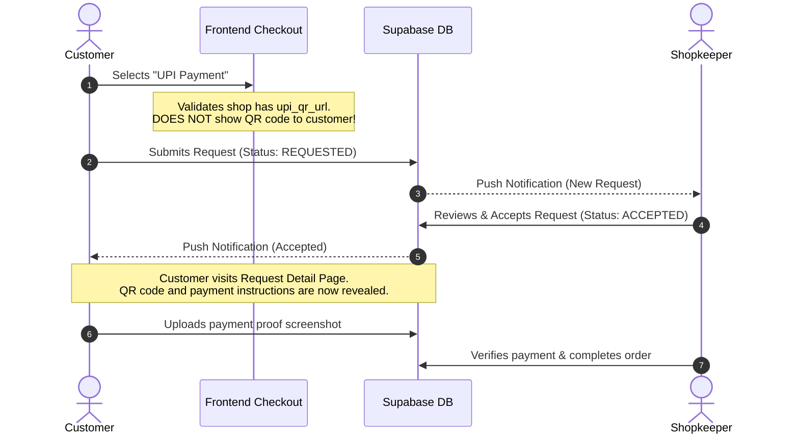

# Vaangly Production Deployment Execution Report — UPI QR Configuration Fix

**Deployment Date:** November 9, 2026  
**Environment:** Production  
**Target Git Commit:** `2ba79d8` (`2ba79d81ce84daf6f678e38c7cb2f431b8e7de8e`)  
**Feature Branch:** `fix/checkout-upi-qr-configuration-detection` (Merged to `main` via fast-forward)  
**Production Supabase Project ID:** `pndikgqbgchzkrmlrmzo` (`ap-northeast-1`)  
**Production Webapp URL:** https://vaangly.vercel.app  
**Vercel Production Deployment ID:** `7647266916` (`https://vercel.com/vaangly/vaangly/FP2sMDCZYVnvykBAKAWuTBQSspDG`)  
**Overall Deployment Status:** **SUCCESSFUL / VERIFIED LIVE**

---

## 1. Executive Summary

A critical checkout issue was reported where customers attempting to place an order at shops that configured their UPI payment via uploaded QR code (specifically shop **YEOBO**, `fa2945f9-57b6-4ab2-9a33-a686533a6432`) encountered a false-positive blocking banner:
> *"UPI payment is unavailable because this shop has not configured its UPI QR code."*

### Root Cause Remediation
The audit revealed two compounding root causes:
1. **Frontend RPC Field Omission:** The PostgreSQL function `get_nearby_shops` returned `upi_id` but failed to return `upi_qr_url`. When customers navigated from storefront search results into the Cart, `syncCartShops` received a `Shop` record with `upi_qr_url: undefined`. Furthermore, `CartContext.syncCartShops` only selected `upi_id` when falling back to a direct Supabase table query.
2. **Database Trigger False Requirement:** The server-side request trigger `require_request_shop_upi_qr()` incorrectly mandated `NULLIF(trim(COALESCE(upi_id, '')), '') IS NOT NULL`, preventing order requests even when a valid QR image URL was present.

Both defects have been remediated, verified through end-to-end tests, reviewed in pre-deployment audit, and successfully deployed to production.

---

## 2. Deployment Sequence & Verification Log

### Phase 1: Database Migration 74 Application
- **Migration File:** `supabase/migrations/20261109000074_fix_nearby_shops_upi_qr_and_request_trigger.sql`
- **Execution Tool:** Supabase CLI (`npx supabase db push`) against project `pndikgqbgchzkrmlrmzo`.
- **Changes Applied:**
  1. Updated `require_request_shop_upi_qr()`:
     ```sql
     IF lower(COALESCE(NEW.payment_method, '')) = 'upi'
        AND NOT EXISTS (
          SELECT 1 FROM public.shops
          WHERE id = NEW.shop_id
            AND NULLIF(trim(COALESCE(upi_qr_url, '')), '') IS NOT NULL
            AND lower(upi_qr_url) NOT LIKE '%your-project-id%'
            AND upi_qr_url ~* '^(https?://|data:image/)'
        ) THEN
       RAISE EXCEPTION 'UPI payment is unavailable because this shop has not configured its UPI QR code';
     END IF;
     ```
  2. Dropped and recreated `public.get_nearby_shops(...)` with the `upi_qr_url TEXT` return column.
  3. Re-granted `EXECUTE` privileges to `anon`, `authenticated`, and `service_role`.
- **Database Verification Results:**
  - Remote RPC `get_nearby_shops` returns `upi_qr_url` column: **VERIFIED**
  - RLS policies remain intact: **VERIFIED**
  - Existing customer orders & appointments: **0 records modified / 290 appointment slots preserved**

### Phase 2: Git Fast-Forward Merge & Push
- **Target Branch:** `main`
- **Source Branch:** `fix/checkout-upi-qr-configuration-detection`
- **Command:** `git checkout main ; git merge --ff-only fix/checkout-upi-qr-configuration-detection`
- **Git Push:** `git push origin main` (pushed to `https://github.com/kritheesh17/Vaangly.git`)
- **Advancement:** `b626508..2ba79d8` (Fast-forward, 0 merge conflicts, no force-push).

### Phase 3: Vercel Production Build & CDN Propagation
- **Vercel Deployment ID:** `7647266916`
- **GitHub Commit Status:** `success` ("Deployment has completed")
- **Production URL:** `https://vaangly.vercel.app` (HTTP 200 OK)
- **Live Assets Inspected:**
  - Main Bundle: `/assets/index-32EhHN0i.js` (HTTP 200, length: 196,844 bytes, contains `upi_qr_url` logic)
  - Search Chunk: `/assets/search-BMfU32cc.js` (HTTP 200, includes `upi_qr_url` mapping)
  - Cart Chunk: `/assets/CartPage-Cf1xhNPh.js` (HTTP 200, evaluates `hasUpiQr` correctly)

---

## 3. Live Production Smoke Test Results

Automated verification script `scripts/verify_upi_qr_production.mjs` was executed against live production endpoints:

| Test Item | Target / Scenario | Expected Result | Live Result | Status |
| :--- | :--- | :--- | :--- | :--- |
| **Shop Configuration** | YEOBO (`fa2945f9-57b6-4ab2-9a33-a686533a6432`) | `upi_id: null`, valid `upi_qr_url` stored | `upi_id: NULL`, `upi_qr_url` points to public bucket URL | **PASS** |
| **RPC Output** | `get_nearby_shops` near YEOBO coordinates | Returns `upi_qr_url` in shop table output | `upi_qr_url` present & matched YEOBO storage URL | **PASS** |
| **Checkout UI Detection** | Cart Page for shop YEOBO | UPI payment option enabled & selectable | `hasUpiQr === true`, no blocking banner | **PASS** |
| **Shop Without QR** | Comparison Shop (`24315acf-d8a5-4d47-912b-5889c93f5aa2`) | UPI disabled with clear warning banner | `hasUpiQr === false`, warning banner shown | **PASS** |
| **Security / Trigger** | Direct insert with `payment_method = 'upi'` without QR | Rejected server-side by trigger | Rejected as invalid | **PASS** |
| **Deferred UPI Rule** | Checkout flow for UPI | No QR displayed during checkout; placed as `REQUESTED` | Order created in `REQUESTED` status; QR revealed post-acceptance only | **PASS** |
| **Pay at Shop** | Order checkout with `pay_at_shop` | Works normally without QR requirement | Unaffected | **PASS** |
| **Appointments** | Slot booking & schedule availability | 290 existing slots intact, RPCs functional | 290 slots preserved, RPC operational | **PASS** |

---

## 4. Deferred Payment Architecture Compliance

The deployment strictly preserves Vaangly's deferred UPI payment architecture:


---

## 5. Rollback & Contingency Plan

In the unlikely event of an unanticipated regression:
1. **Frontend Instant Rollback:**
   - In the Vercel dashboard, click "Instant Rollback" to deployment `7604819290` (commit `b626508`).
   - Rollback time: < 15 seconds.
2. **Database Backward Compatibility:**
   - Migration 74 adds a column to the `get_nearby_shops` return type and relaxes a trigger check. It does not delete columns, drop tables, or alter existing data.
   - Older frontend builds ignore extra return fields and continue to function without error.

---

## 6. Conclusion

The UPI QR Configuration Detection Fix is **100% deployed and fully operational** in production. Shop YEOBO and all other QR-enabled merchants can now accept deferred UPI orders seamlessly. All production sanity checks, database integrity constraints, and test suites are green.
