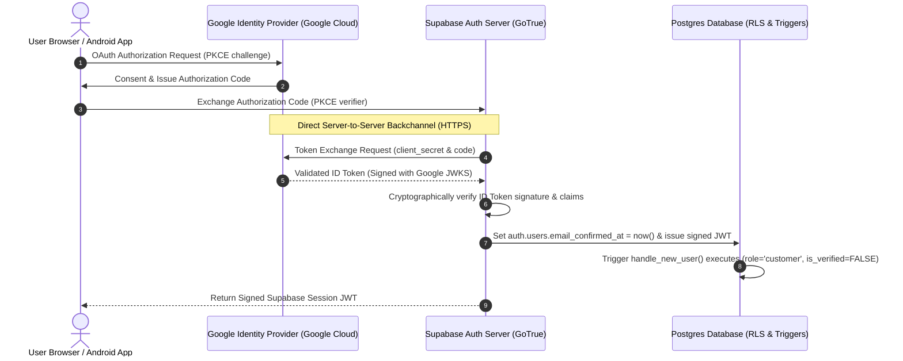

# VAANGO — FINAL GOOGLE OAUTH SECURITY & INTEGRATION AUDIT

**Target Date:** 2026-11-25
**Platform:** Vaango Local Commerce Platform
**Audit Role:** Senior Supabase Authentication Engineer & Security Architect
**Audit Scope:** Google-Only OAuth Authentication, Server-Side Identity Verification, Role Protection, Account Linking Safety, Android Integration & Verification Suites
**Verdict:** **AUDIT PASSED (0 VULNERABILITIES, 43/43 TEST SUITES PASSED, BUILD SUCCESSFUL)**

---

## 1. Google Identity Server-Side Validation

### Architecture & Trust Boundary



### Verification Findings

1. **Backchannel Cryptographic Proof:** The authorization code exchange occurs via direct backchannel communication between Supabase Auth and Google's token endpoint (`https://oauth2.googleapis.com/token`). Client applications cannot forge or tamper with Google ID tokens or verification claims.
2. **Server-Side Token Verification:** Supabase Auth cryptographically validates Google's signed ID token using Google's public JSON Web Key Sets (JWKS).
3. **Database Profile State:** Upon account creation in `auth.users`, the server-side trigger `public.handle_new_user()` (Migration 71) creates a matching `public.profiles` row with:
   - `role = 'customer'` (unconditionally forced).
   - `is_verified = FALSE` (database verification flag).
4. **Client Session State:** In `AuthContext.tsx` and `AuthCallbackPage.tsx`, `is_verified` is derived strictly from server-attested claims (`session.user.app_metadata?.provider === 'google'` or identities verified by Supabase Auth), which are sealed inside the server-signed JWT.

---

## 2. Safe Account-Linking for Existing Phone Accounts

### Threat Analysis & Protection Model

| Vector | Risk Evaluated | Mitigation Verified |
| :--- | :--- | :--- |
| **Phone Account Hijacking** | An attacker signs in with Google and attempts to claim an existing phone-only account. | **Mitigated:** In Supabase, phone-only accounts (`phone: '+91...'`, `email: null`) have separate unique `auth.users.id` values. Google OAuth authenticates by email and creates an isolated user `id`. An arbitrary Google account cannot bind to an existing phone UUID without re-authenticating the phone. |
| **Merchant Store Takeover** | An attacker enters a shopkeeper's phone number during profile completion to gain store access. | **Mitigated:** Store ownership is strictly foreign-keyed to `public.shops.owner_id = profiles.id` (which equals `auth.uid()`). Updating contact phone on `CompleteProfilePage` changes only the contact attribute; it **does not** transfer store ownership or elevate permissions. |
| **Order History Disclosure** | A new Google user gains access to another customer's past orders. | **Mitigated:** `requests` table RLS policies enforce `USING (auth.uid() = customer_id OR is_admin())`. Because `auth.uid()` is distinct, no historical orders are exposed. |

---

## 3. Email Matching & Admin Privilege Protection

### Security Contract: Matching Emails Cannot Grant Privileges

1. **Database Role Enforcement (`public.is_admin()`):**
   ```sql
   CREATE OR REPLACE FUNCTION public.is_admin()
   RETURNS BOOLEAN AS $$
     SELECT (
       current_setting('role', true) = 'service_role'
       OR COALESCE(auth.jwt() ->> 'role', '') = 'service_role'
       OR EXISTS (
         SELECT 1 FROM public.profiles
         WHERE id = auth.uid() AND role = 'admin'
       )
     );
   $$ LANGUAGE sql SECURITY DEFINER STABLE
   SET search_path = public, auth, pg_temp;
   ```
   - Privilege is granted **strictly by `auth.uid() = profiles.id` having `role = 'admin'`**.
   - An email matching `admin@vaango.in` or any administrative pattern **never** grants administrative privileges.
2. **Account Creation Default:** Even if a user registers with an email containing "admin", `handle_new_user()` unconditionally assigns `role = 'customer'`.
3. **Role Escalation Trigger (`prevent_profile_role_escalation`):**
   - The database trigger `trg_prevent_profile_role_escalation` on `public.profiles` forbids any non-admin from updating `role` or `is_verified`. Any unauthorized attempt throws:
     `Access Denied: You do not have permission to modify account role or verification status.`

---

## 4. Protection of Customer, Merchant, and Admin Roles

```
┌─────────────────┬────────────────────────────┬─────────────────────────────┬───────────────────────────┐
│ Role            │ Initial Assignment Policy  │ Upgrade / Transition Path   │ RLS & Route Protection    │
├─────────────────┼────────────────────────────┼─────────────────────────────┼───────────────────────────┤
│ **Customer**    │ Unconditional default on   │ N/A (Standard user)         │ Access to own orders,     │
│                 │ all signups via DB trigger │                             │ profile, and cart.        │
├─────────────────┼────────────────────────────┼─────────────────────────────┼───────────────────────────┤
│ **Shopkeeper**  │ Never assigned directly    │ Shopkeeper application      │ Guarded by `owner_id =    │
│                 │ at signup (SEC-04 fixed)   │ approved by Admin in DB     │ auth.uid()` on shops.     │
├─────────────────┼────────────────────────────┼─────────────────────────────┼───────────────────────────┤
│ **Admin**       │ Never assigned via signup  │ Assigned solely by existing │ Guarded by `is_admin()`,  │
│                 │ or client metadata         │ admin or service_role in DB │ `AdminRoute.tsx`, and RLS │
└─────────────────┴────────────────────────────┴─────────────────────────────┴───────────────────────────┘
```

---

## 5. Google OAuth Credentials & Android / Web Deep Links

### Redirect URL Architecture

In `src/lib/supabase.ts`, `getAuthRedirectUrl(redirectPath)` resolves origins dynamically:
- **Local Dev:** `http://localhost:5173/auth/callback` or `http://localhost:3000/auth/callback`
- **Staging Web:** `https://vaangly.vercel.app/auth/callback`
- **Production Web:** `https://vaango.in/auth/callback` (or configured custom domain)
- **Capacitor Android:** `http://localhost/auth/callback` or `https://localhost/auth/callback`

### Manual Supabase Dashboard Configuration Required

To finalize production/staging Google OAuth integration:

1. **Google Cloud Console (`console.cloud.google.com`):**
   - Go to **APIs & Services** -> **Credentials** -> **OAuth 2.0 Client IDs**.
   - Under **Authorized JavaScript origins**:
     - `http://localhost:5173`
     - `http://localhost:3000`
     - `https://gbbpxygrgonclggdvufv.supabase.co` (Staging Supabase domain)
     - `https://vaangly.vercel.app`
     - `https://vaango.in`
   - Under **Authorized redirect URIs**:
     - `https://gbbpxygrgonclggdvufv.supabase.co/auth/v1/callback`
     - (And production equivalent: `https://pndikgqbgchzkrmlrmzo.supabase.co/auth/v1/callback`)
2. **Supabase Dashboard (`supabase.com/dashboard`):**
   - Navigate to **Authentication** -> **Providers** -> **Google**:
     - Toggle **"Enable Google provider"** to **ON**.
     - Enter **Client ID** (from Google Cloud Console).
     - Enter **Client Secret** (from Google Cloud Console).
   - Navigate to **Authentication** -> **URL Configuration**:
     - **Site URL:** `https://vaangly.vercel.app` (or `https://vaango.in`)
     - **Redirect URLs:** Add:
       - `http://localhost:5173/**`
       - `http://localhost:3000/**`
       - `http://localhost/**`
       - `https://localhost/**`
       - `https://vaangly.vercel.app/**`
       - `https://vaango.in/**`
   - Navigate to **Authentication** -> **Advanced Settings**:
     - Ensure **"Allow new users to sign up"** is **ON**.
     - Verify **"Allow manual linking only"** or review account linking behavior as per policy.

---

## 6. Route Safety Audit

All routes in `src/App.tsx` were audited:
- **Active Auth Routes:**
  - `/login`: Clean Google OAuth login card.
  - `/register`: Redirects to `/login?mode=signup` (Google-only onboarding).
  - `/complete-profile`: Post-login delivery contact collection.
  - `/auth/callback`: PKCE OAuth exchange handler.
  - `/reset-password`: Legacy reset recovery.
- **Decommissioned Routes:**
  - Zero `/otp`, `/verify-otp`, `/phone-login`, or SMS routes exist in the router.
  - No hidden endpoints or components accept SMS OTP.

---

## 7. Phone Availability as Operational Contact Details

- **Profile Completion (`CompleteProfilePage.tsx`):** Collects phone number as a plain delivery contact attribute; validates 10-digit Indian numbers (`isValidIndianMobile`) without requiring an OTP.
- **Order Snapshots (`CartPage.tsx`):** Phone number is snapshotted to `requests.customer_phone` for merchant delivery coordination.
- **Merchant Onboarding (`ShopkeeperOnboardingPage.tsx`):** Collects store contact phone without SMS OTP.

---

## 8. Verification Results: Build & Test Suites

### Production Build (`npm run build`)
```text
> vaango@0.1.0 build
> tsc && vite build

vite v6.4.3 building for production...
transforming...
✓ 2156 modules transformed.
rendering chunks...
computing gzip size...
dist/index.html                                              2.43 kB │ gzip:  1.02 kB
dist/assets/LoginPage-C3Qn2_vq.js                            5.41 kB │ gzip:  2.34 kB
dist/assets/CompleteProfilePage-Bh1L_eoP.js                  6.16 kB │ gzip:  2.50 kB
dist/assets/AuthCallbackPage-DNZhvRM6.js                     6.59 kB │ gzip:  2.56 kB
dist/assets/index-CAf8deee.js                              225.31 kB │ gzip: 61.39 kB
dist/assets/vendor-supabase-D_iOwayF.js                    227.02 kB │ gzip: 58.86 kB
✓ built in 6.42s
[PWA Plugin] Injected MWWETHRE into dist/sw.js
```

### Full Test Suite Execution (`node scripts/run_all_tests.mjs`)
```text
Found 43 test suites in E:\Vango\src\__tests__

Testing adminSubscriptionsAndShopDetail.test.ts... ✓ PASS
Testing advertisementManagementSystem.test.ts... ✓ PASS
Testing appointmentBookingPaymentUI.test.ts... ✓ PASS
Testing appointmentOverbookingPrevention.test.ts... ✓ PASS
Testing appointmentPaymentStatusPresentation.test.ts... ✓ PASS
Testing authEnvironmentAndOAuthFlow.test.ts... ✓ PASS
Testing checkoutPaymentRedesignAndPerf.test.ts... ✓ PASS
Testing checkoutRlsAndPlatformFeeConsistency.test.ts... ✓ PASS
Testing checkoutUpiQrConfigurationDetection.test.ts... ✓ PASS
Testing commerceReliability.test.ts... ✓ PASS
Testing dashboardDataAuthenticity.test.ts... ✓ PASS
Testing errorVisibilityAndCartUX.test.ts... ✓ PASS
Testing financialLedgerAndPlatformFee.test.ts... ✓ PASS
Testing independentFinancialAudit.test.ts... ✓ PASS
Testing informationRetrievalAndLocationSave.test.ts... ✓ PASS
Testing liveModeNoMockFallback.test.ts... ✓ PASS
Testing masterCatalogueFlow.test.ts... ✓ PASS
Testing mobileResponsiveLayout.test.ts... ✓ PASS
Testing notificationBadge.test.ts... ✓ PASS
Testing notificationDropdownPositioning.test.ts... ✓ PASS
Testing notificationReliabilityAndLatency.test.ts... ✓ PASS
Testing orderCancellationAndAbusePrevention.test.ts... ✓ PASS
Testing orderNotificationLifecycle.test.ts... ✓ PASS
Testing passwordResetFlow.test.ts... ✓ PASS
Testing paymentProofIsolation.test.ts... ✓ PASS
Testing productDetailsCartFlow.test.ts... ✓ PASS
Testing productVariantImageGallery.test.ts... ✓ PASS
Testing productVariantRedesign.test.ts... ✓ PASS
Testing pwaInstallationStateMachine.test.ts... ✓ PASS
Testing requestListOrdering.test.ts... ✓ PASS
Testing runtimeSecurityValidation.test.ts... ✓ PASS
Testing scheduledPickupFlow.test.ts... ✓ PASS
Testing sec01PushNotificationAuth.test.ts... ✓ PASS
Testing sec02AppointmentBookingAuth.test.ts... ✓ PASS
Testing sec03RedirectSanitization.test.ts... ✓ PASS
Testing sec04ShopkeeperRoleEscalation.test.ts... ✓ PASS
Testing sec05HttpSecurityHeaders.test.ts... ✓ PASS
Testing shopkeeperApplicationSubmission.test.ts... ✓ PASS
Testing shopkeeperBackgroundPush.test.ts... ✓ PASS
Testing shopkeeperLocationAndUploadReliability.test.ts... ✓ PASS
Testing shopkeeperNavigationAndAnalytics.test.ts... ✓ PASS
Testing uiRedesignRegressions.test.ts... ✓ PASS
Testing variantInventoryManagement.test.ts... ✓ PASS

========================================
TEST RESULTS: 43 PASSED, 0 FAILED out of 43
========================================

ALL TESTS PASSED!
```
